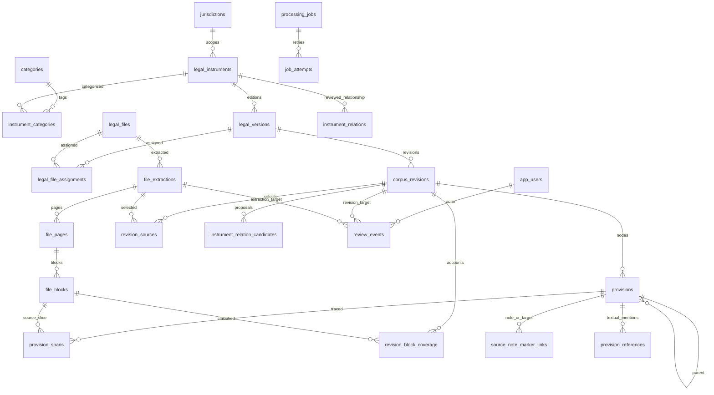

# LegalMind technical handover: Abdullah / Phase B

**Verified against the backend working tree and development PostgreSQL database on 9 October 2026.** Base corpus counts were observed at 07:16:20 UTC; approval states and review-event counts were rechecked at 09:20:30 UTC after the local approval workflow was added. The live database is the authority for counts; code and migrations are the authority for implemented behavior. Paths below are relative to `legalmind-backend/` unless marked `legalmind-frontend/`. The working tree contains uncommitted changes, so use this document with the exact code revision you receive, not an older branch checkout.

## 1. Executive summary and status legend

**Phase B tables and pipeline have not been built in the current legal corpus.** Haroon's pipeline registers Acts/Rules PDFs, saves per-page extraction and blocks, parses legal trees with exact source spans, and offers local inspectors and read-only audits. A local-only approval action records Phase B handoff decisions. The **23 latest revisions** were approved in the development database with unresolved findings explicitly acknowledged; 64 historical revisions remained drafts at the time of this snapshot. These approvals are **not** certification of legal accuracy, current applicability, or production publication readiness. The proposed Phase B tables do not exist. The 30-section `/ask` application code was removed; historical migrations remain for upgrade compatibility.

| Label | Meaning here |
|---|---|
| **IMPLEMENTED** | Code path and current database object exist; not necessarily reviewed or production-ready. |
| **PARTIAL** | Some supporting schema/code exists, but the end-to-end gate or workflow is missing. |
| **PHASE B TO BUILD** | Abdullah's future implementation; examples are proposals, not existing tables or APIs. |
| **BLOCKED** | Requires a real approval/review decision or a verified source correction before publication. |

| Boundary | Owner | Input → output | Current reality |
|---|---|---|---|
| Phase A: upload → extraction/OCR → pages/blocks → structure → review/approval | Haroon | Original PDFs → **approved** structured revisions | Ingestion and local exception-acknowledged approval implemented; human legal/source verification is incomplete. |
| Phase B: legal chunks → keyword index → embeddings → publication → first-stage retrieval | Abdullah | Approved revisions → ranked, citable candidates | New-corpus chunk/index/publication/retrieval absent. |
| Phase C: rerank → context/evidence gate → prompt/LLM → citation verification | Shimza | Ranked candidates → grounded answer | Not a Phase B deliverable; contract requirements described below. |

```text
SOURCE PDF (file hash, law edition)
  → extraction job → file_extractions → file_pages → file_blocks
  → structure job → corpus_revisions [DRAFT] → provisions + provision_spans
                       ↘ source notes / references / block coverage / audits
  → local approval decision [IMPLEMENTED; exceptions may remain]
  → separate human legal/source verification [STILL OPEN]
  → approved revision IDs
  → chunk sets → keyword/vector indexes → validated publication [PHASE B]
  → exact + lexical + semantic candidate retrieval / RRF [PHASE B]
  → rerank / context / evidence / LLM / citation validation [PHASE C]
```

The legal corpus is distinct from private uploaded contracts (`documents`, `document_versions`, `contract_pages`, `contract_clauses`, `contract_clause_spans`). Never put a user's contract text into the authoritative-law index. Categories are catalog metadata, not a user-selected retrieval switch. [Sources: `app/db/models.py`, `app/db/legal_corpus_models.py`, `app/repositories/document_repository.py`.]

## 2. Live state and immediate blockers

At the observation times above the development database was at Alembic `20261009_12` with 29 public tables, including five private-contract tables and `alembic_version`. Counts are across **all historical attempts**, unless noted. Approval/review-event figures reflect the later recheck. [Verified by read-only PostgreSQL queries of `pg_tables`, `alembic_version`, and the listed tables.]

| Item | Observed state |
|---|---:|
| Registered legal PDFs / instruments / legal versions | 23 / 23 / 23 |
| Extraction runs / saved page rows / saved blocks | 28 / 241 / 1,912 |
| Latest-revision physical pages across the 23 editions | 199 |
| All revisions / revision-source selections | 87 / 87 |
| Revision states | **23 approved** (one latest revision per edition); 64 older historical drafts |
| Latest parser versions | v5: 1; v6: 1; v7: 2; v8: 3; v10: 9; v11: 2; v12: 5 |
| All saved page outcomes | 215 `extracted`; 26 `needs_review` |
| Latest selected pages still `needs_review` | **18** (12 have a local `mark_blank` event; 6 have no page decision) |
| All review events / revision-level approval events | 40 total: 17 `mark_blank`, **23 `approve`** |
| Provisions / source-span rows / note-marker links | 12,268 / 16,992 / 2,348 |
| Block coverage rows | 7,134: 6,559 mapped, 575 ignored, 0 partial/unmapped across historical revisions |
| Reference mentions / proposed instrument relations / reviewed instrument relations | 2,519 / 367 / 0 |
| Extraction methods across all saved pages | 219 native, 22 none; **0 OCR/mixed actually persisted** |
| Phase B chunk/embedding/publication tables; active publication | **None; none** |
| `vector` extension | Installed, but no current legal-corpus vector column/index |

All 23 extraction jobs and 87 structure jobs show `completed`; that only means those workers finished. It does **not** mean every physical page is verified, legal hierarchy is correct, or an edition is current law. The approval preflight found **9 errors and 8 warnings** across latest persisted revisions, plus pages still marked `needs_review`; these were explicitly acknowledged in the 23 local approval events, **not fixed**. Findings include hierarchy cases in the Arms and Consumer Protection drafts. The audit service is a detector, not a human sign-off. Older reports may refer to prior parser versions; always recheck the **latest persisted** revision. [Sources: `app/repositories/legal_structure_repository.py::audit/approval_check/approve`, `app/services/legal_audit.py`; live preflight and DB counts.]

**Indexing gate today: 23 latest revisions meet the stored `review_state='approved'` condition.** The new local-only endpoint checks completed structure jobs, current revision, hash, source/page presence, exact-span integrity and coverage, then records an explicit reason and unresolved audit/page exceptions. Its approver identity is labelled **not verified** because this local screen has no login. The schema constraint and local decision do **not** prove page-by-page visual review, correct legal hierarchy, note/table fidelity or current applicability. Abdullah may prototype chunking from these pinned IDs, but must carry the open exceptions into QA and must not treat an active public search publication as legally validated. Production publication still requires a stronger authenticated review/sign-off policy and correction of confirmed structural errors. [Sources: `app/db/legal_corpus_models.py::CorpusRevision`, `app/repositories/legal_structure_repository.py::approval_check/approve`, `app/api/routes/legal_ingestion.py`.]

Abdullah can now build against the **23 explicitly approved development revisions**, while preserving each revision ID/hash and its exception record. Isolated synthetic fixtures remain useful for tests. Never silently promote an older draft or a partially indexed publication. [Source: live approval states and present review-state constraint.]

## 3. Phase A data contract: what each layer means

1. `legal_instruments` is the stable Act/Rules/Ordinance identity, scoped to `jurisdictions` by `(jurisdiction_id, citation_key)`. `legal_versions` is a particular edition/source snapshot, not a parser run. `categories` and `instrument_categories` tag instruments; do not rely on a questioner choosing one. The version's effective dates and `applicability_status` may be unknown/unverified; do not infer current applicability. [Sources: `app/db/legal_corpus_models.py::LegalInstrument/LegalVersion`, `app/repositories/legal_ingestion_repository.py::register_upload`.]
2. `legal_files` identifies immutable PDF bytes by SHA-256; `object_key` is a local content-addressed path under configured `LEGAL_UPLOAD_DIR` (default `uploads/legal`), **not a PostgreSQL PDF blob**. `legal_file_assignments` records which edition a file supplies and whether primary/supplement/amendment. A revision selects one completed extraction per assigned PDF through `revision_sources`. [Sources: `app/services/legal_upload.py::store_legal_pdf`, `app/repositories/legal_structure_repository.py::create_revision`.]
3. `file_extractions` identifies one extraction configuration/output. `file_pages.page_index` is the **1-based physical PDF page**, separate from optional `printed_label`. `raw_text` is the saved extraction; `normalized_text` is sanitized text used downstream. `file_blocks` preserve ordered headings/paragraphs/tables/notes/figures, bounding boxes, offsets into page text, and warnings. OCR is routed when necessary, but none has been persisted in this corpus yet; an OCR result would still require review. [Sources: `app/services/legal_extraction.py::extract_page/_build_blocks`, `app/workers/legal_extract.py::process_one`; live DB methods.]
4. `corpus_revisions` is a parse/correction of one **legal version**, with `revision_number`, parser/normalizer versions, content hash, parser report, and review state. Historical revisions remain separate. `provisions` is an ordered parent tree. Kinds allowed are `preamble`, `part`, `chapter`, `section`, `subsection`, `paragraph`, `rule`, `schedule`, `article`, `other`; nested roman items may also be `paragraph` nodes rather than a separate `subparagraph` enum. `label` and `reference_path` are text, so `19A`, `(da)`, and schedules are possible. `ordinal` is unique inside a revision and represents parser order. [Sources: `app/db/legal_corpus_models.py::CorpusRevision/Provision`, `app/services/legal_structure.py::make_node`.]
5. `provisions.own_text` contains **only that node's own assigned text**. A parent and its children do not each contain the same entire section. A parent continuation can appear after the last child; concatenating `parent.own_text` and child texts blindly can put text in the wrong order. For exact display/reconstruction, combine approved node spans in physical source order (`file`, `page_index`, `block_ordinal`, `block_char_start`) and preserve the selected source role. For search, avoid forcing unrelated children into one chunk. [Sources: `app/services/legal_structure.py::append`, `app/db/legal_corpus_models.py::ProvisionSpan`.]
6. `provision_spans` maps a slice of one node's `own_text` to a slice of one `file_blocks.normalized_text`, with `revision_id`, extraction/page/block IDs and exact character offsets. The save transaction checks both slices match and prevents overlapping source spans. The composite FKs prevent a span citing an unselected extraction or another revision. This validates stored slices, **not** whether the PDF's visible legal meaning or parent assignment is correct. [Sources: `app/repositories/legal_structure_repository.py::complete`, `app/db/legal_corpus_models.py::ProvisionSpan`.]
7. Footnotes and amendment histories become `provisions.kind='other'` (often `heading='Source note N'`), with exact spans. `source_note_marker_links` links a printed numeric marker to its note and optional target provision; null target means unresolved. Contents/front matter can also be `other` nodes (e.g. `Contents`, `Contents continuation`), and running headers can be retained separately or intentionally ignored. **Do not chunk `other` as operative law by default.** `provision_references` are textual mentions, mostly unresolved; `instrument_relation_candidates` are source-backed proposals, not verified current legal effects. [Sources: `app/services/legal_structure.py::parse_structure`, `app/db/legal_corpus_models.py` note/reference models, `app/repositories/legal_structure_repository.py::relationship_candidates`.]
8. `source_status IN ('omitted','repealed','deleted')` records what is explicitly shown in the source or a linked note. Null means no such label was established, **not** affirmative proof of currently effective law. Historical wording should stay in note records, never mixed into operative embeddings. [Sources: `app/services/legal_status.py`, `app/services/legal_structure.py` status pass, `alembic/versions/20261008_10_provision_source_status.py`, `20261008_11_deleted_source_status.py`.]
9. `revision_block_coverage` says whether a saved block was mapped, partial, ignored, or unmapped and why. Its 100% accounting is useful for audit but **not** a correctness certificate. `review_events` records local page mark-blank actions and now 23 revision approval decisions, including reasons and acknowledged exception codes. [Sources: `app/repositories/legal_structure_repository.py::audit/approve`, `app/repositories/legal_extraction_repository.py::mark_blank`, `app/db/legal_corpus_models.py::ReviewEvent`.]

### Legal hierarchy and stable paths

```text
legal_instrument (identity) → legal_version (edition) → corpus_revision (parse)
  Part/Chapter [optional] → Section (or Rule/Article) → Subsection
  → Paragraph → nested Paragraph (e.g. roman item)
  Schedule → its children [where parsed]
  Other → preamble/contents/source notes/running furniture [inspect before use]
```

Each `provisions.parent_id` must point to another node in the same revision, enforced by composite FK `(parent_id, revision_id)`. A path is scoped to a **revision**, not globally: e.g. the parser builds a file prefix `f:<file_uuid>` followed by segments such as `/s:7/sub:1/p:a`. Do not hardcode an example path as a guaranteed public format; persist the actual `reference_path`, `revision_id`, and `provision_id`. Different Acts can both have Section 7. Exact lookup must first resolve jurisdiction/instrument/edition/publication. [Sources: `app/services/legal_structure.py::make_node`, `app/db/legal_corpus_models.py::Provision`.]

## 4. Real schema: map and conventions

The next section documents the **23 actual Phase A tables** in the live database. The five separate contract tables and `alembic_version` are deliberately outside Abdullah's authoritative-law input. In column lists, `!` means `NOT NULL`, `?` nullable; `=...` is a PostgreSQL default. UUID IDs use application-side `uuid4()` where created by the ORM; there is **no database UUID default** unless explicitly listed. `timestamptz` means PostgreSQL `timestamp with time zone`, `varchar(n)` means character varying, and `jsonb` is PostgreSQL JSONB. All types, nullability, keys, defaults, and index names below were checked against `pg_catalog` on the observation date. Check-constraint rules were cross-checked in `app/db/legal_corpus_models.py` and migrations. Unless stated otherwise, Abdullah reads these tables but does **not** write them. [Sources: live `pg_attribute`, `pg_constraint`, `pg_indexes`; `app/db/legal_corpus_models.py`, Alembic revisions `20261005_05`–`20261008_11`.]



ERD edges summarize the **implemented** FKs; several are composite (especially revision/source/span scoping) and the full list is below. `processing_jobs` may target a file, extraction, **or** revision; its check constraint requires exactly one target. `review_events` similarly targets an extraction **or** revision. No Phase B entity appears in this ERD because none exists yet. [Source: `app/db/legal_corpus_models.py`.]

### Schema reference and ownership

| Actual table | Purpose / PK | Most important FK(s) | Producer → Abdullah |
|---|---|---|---|
| `app_users` | Review identity / `id` | — | Phase A identity; read only |
| `jurisdictions` | Jurisdiction tree / `id` | `parent_id → jurisdictions` | Phase A registry; read |
| `categories` | Catalogue tree / `id` | `parent_id → categories` | Phase A registry; read |
| `legal_instruments` | Stable law / `id` | `jurisdiction_id → jurisdictions` | Phase A registry; read |
| `instrument_categories` | Law-category junction / `(instrument_id,category_id)` | instrument, category | Phase A registry; read |
| `legal_versions` | Legal edition / `id` | `instrument_id → legal_instruments` | Phase A registry; read |
| `legal_files` | Original PDF metadata / `id` | `uploaded_by → app_users` | Phase A upload; read |
| `legal_file_assignments` | PDF-to-edition role / `(file_id,legal_version_id)` | file, version, actor | Phase A upload; read |
| `file_extractions` | Extraction run / `id` | `file_id → legal_files` | Phase A worker; read |
| `file_pages` | Physical page/output / `id` | `extraction_id → file_extractions` | Phase A worker/review; read |
| `file_blocks` | Located text/table/note block / `id` | `(page_id,extraction_id) → file_pages` | Phase A worker; read |
| `corpus_revisions` | Versioned legal tree / `id` | `legal_version_id → legal_versions`; approver | Phase A structure/review; **approved only for production input** |
| `revision_sources` | Selected extraction(s) / `(revision_id,extraction_id)` | composite revision/edition, extraction/file, assignment | Phase A structure; read |
| `provisions` | Legal nodes / `id` | revision; `(parent_id,revision_id)` self-FK | Phase A parser; read |
| `provision_spans` | Exact node-to-block slices / `id` | composite node/revision, source/revision, page/block | Phase A parser; read |
| `source_note_marker_links` | Printed note marker / `id` | note/target node, source block, revision | Phase A parser; read cautiously |
| `provision_references` | Raw textual cross-references / `id` | source node; optional instrument | Phase A parser; read, do not assume resolved |
| `instrument_relation_candidates` | Source-backed relation proposals / `id` | revision, source node, evidence span, optional target | Phase A parser; read as proposals |
| `revision_block_coverage` | Auditable block classification / `id` | revision/source, source block | Phase A parser; read |
| `instrument_relations` | Reviewed law-to-law links / `id` | two instruments, optional source node/reviewer | Phase A future review; currently empty; read |
| `review_events` | Immutable review actions / `id` | actor and exactly one base target | Phase A review; read |
| `processing_jobs` | Durable extract/structure/verify work / `id` | exactly one target file/extraction/revision | Phase A workers; read |
| `job_attempts` | Retry/heartbeat trail / `id` | `job_id → processing_jobs` | Phase A workers; read |

### Column-level reference: registry and source PDF

For every table in this section, the producer is Haroon's upload/worker/review workflow and Abdullah has **read-only** access. PKs create btree indexes implicitly; named secondary indexes are stated separately. `now()` and JSON defaults below are database defaults; UUID values are generated by application code. `RESTRICT` on source FKs is intentional: a chunking migration must not erase Phase A provenance. [Source for this entire schema reference: `app/db/legal_corpus_models.py`; checked against the live `public` schema.]

**`app_users`** — identity for uploader/reviewer; created by the local ingestion/review path. Columns: `id uuid!` PK; `auth_provider varchar(50)!`, `auth_subject varchar(255)!`, `display_name varchar(200)?`, `role varchar(20)! = 'user'`, `created_at timestamptz! = now()`. Unique `(auth_provider, auth_subject)`; `role` check is `admin|user`. No password column. FKs: none. Do not assume this is a production authentication system.

**`jurisdictions`** — where a law belongs; created at registration. Columns: `id uuid!` PK; `code varchar(50)!`, `name varchar(200)!`, `parent_id uuid?`. `parent_id → jurisdictions.id`; unique `code`; nonblank-code check. A self-parent chain is a taxonomy, not evidence that a law automatically applies in a child jurisdiction.

**`categories`** — admin catalogue labels, not a mandatory user query filter; created at registration. Columns: `id uuid!` PK; `slug varchar(100)!`, `name varchar(200)!`, `parent_id uuid?`. `parent_id → categories.id`; unique `slug`; nonblank-slug check.

**`legal_instruments`** — stable Act/Rules/Ordinance identity; created/reused at registration. Columns: `id uuid!` PK; `jurisdiction_id uuid!`, `instrument_type varchar(20)!`, `canonical_title text!`, `citation_key varchar(160)!`, `aliases jsonb! = []`, `created_at timestamptz! = now()`. `jurisdiction_id → jurisdictions.id`; unique `(jurisdiction_id,citation_key)`; allowed type `act|rule|regulation|ordinance|other`; nonblank key. The upload API currently accepts a narrower subset than the DB enum. Do not use title alone as an identity key.

**`instrument_categories`** — many-to-many catalogue link; added at registration. Columns: `instrument_id uuid!`, `category_id uuid!`; composite PK `(instrument_id,category_id)`. FKs to `legal_instruments.id` (cascade on instrument deletion) and `categories.id` (restrict). No separate secondary index or timestamp.

**`legal_versions`** — an edition/source snapshot, **not** a parser version; created/reused at registration. Columns: `id uuid!` PK; `instrument_id uuid!`, `edition_key varchar(160)!`, `publication_date date?`, `effective_from date?`, `effective_to date?`, `applicability_status varchar(20)! = 'unknown'`, `date_source text?`, `notes text?`, `created_at timestamptz! = now()`. FK `instrument_id → legal_instruments.id`; unique `(instrument_id,edition_key)` and `(id,instrument_id)` (the latter supports scoped composite FK); secondary `ix_legal_versions_instrument_id`. Effective end must be later than start if both supplied; applicability values `verified|unverified|unknown`. The current database often does **not** establish authoritative current effect.

**`legal_files`** — original PDF identity and storage locator; inserted once per unique hash at upload. Columns: `id uuid!` PK; `original_filename varchar(255)!`, `object_key text!`, `sha256 varchar(64)!`, `byte_size integer!`, `media_type varchar(100)!`, `page_count integer!`, `source_url text?`, `publisher varchar(200)?`, `acquired_at timestamptz?`, `uploaded_by uuid?`, `created_at timestamptz! = now()`. FK `uploaded_by → app_users.id`; unique `object_key` and `sha256`; size/pages positive and SHA-256 lower-case hex checks. `object_key` addresses local bytes; PostgreSQL stores metadata, not the PDF itself. No special secondary index beyond unique indexes.

**`legal_file_assignments`** — binds source PDF to the correct edition, with source role; added at registration. Columns: `file_id uuid!`, `legal_version_id uuid!`, `assignment_role varchar(20)!`, `assigned_by uuid?`, `notes text?`, `created_at timestamptz! = now()`. PK `(file_id,legal_version_id)`; FKs to `legal_files`, `legal_versions`, and optional `app_users`; role `primary|supplement|amendment`; secondary `ix_legal_file_assignments_version_id`. Reusing one byte-identical PDF across assignments does not make editions interchangeable.

### Column-level reference: extraction and legal revision

**`file_extractions`** — one extraction run/configuration for a file; created by extract worker. Columns: `id uuid!` PK; `file_id uuid!`, `engine_name varchar(100)!`, `engine_version varchar(100)!`, `ocr_engine varchar(100)?`, `ocr_languages varchar(100)?`, `config_sha256 varchar(64)!`, `output_sha256 varchar(64)?`, `processing_status varchar(20)! = 'pending'`, `started_at timestamptz?`, `completed_at timestamptz?`, `created_at timestamptz! = now()`. FK to `legal_files.id`; unique `(id,file_id)` for scoped source selection; `ix_file_extractions_file_id`; status `pending|running|completed|failed`; completed requires output hash and completion time. A file can have multiple historical extractions.

**`file_pages`** — one 1-based physical page per extraction, including blank/problem pages; created by extract worker and reviewed via events. Columns: `id uuid!` PK; `extraction_id uuid!`, `page_index integer!`, `printed_label varchar(100)?`, `width_pt numeric(10,3)?`, `height_pt numeric(10,3)?`, `rotation_deg integer?`, `raw_text text! = ''`, `normalized_text text! = ''`, `text_sha256 varchar(64)?`, `extraction_method varchar(20)!`, `outcome varchar(30)!`, `exclusion_reason text?`, `ocr_confidence numeric(5,4)?`, `warnings jsonb! = []`, `table_regions jsonb! = []`, `created_at timestamptz! = now()`. FK to extraction; unique `(extraction_id,page_index)` and `(id,extraction_id)`; method `native|ocr|mixed|none`, outcome `extracted|verified_blank|excluded_with_reason|failed|needs_review`; exclusion needs a nonblank reason, OCR confidence must be 0–1, dimensions positive/pairwise, rotation 0/90/180/270. No dedicated secondary index beyond uniques. **Never equate `printed_label` with physical page index.**

**`file_blocks`** — ordered extracted units within a page; created by extract worker. Columns: `id uuid!` PK; `extraction_id uuid!`, `page_id uuid!`, `block_ordinal integer!`, `block_kind varchar(20)!`, `raw_text text! = ''`, `normalized_text text! = ''`, `text_sha256 varchar(64)?`, `page_char_start integer?`, `page_char_end integer?`, `bbox jsonb?`, `warnings jsonb! = []`, `created_at timestamptz! = now()`. Composite FK `(page_id,extraction_id) → file_pages(id,extraction_id)`; unique `(page_id,block_ordinal)` and `(id,page_id,extraction_id)`; `ix_file_blocks_page_id`; ordinal positive; page-offset range either both null or valid; kind `heading|paragraph|table|footnote|note|header|footer|figure|other`. `bbox` is extraction geometry, not a proven citation by itself.

**`corpus_revisions`** — versioned parser output and local review/handoff state for one edition; inserted as draft when a structure job is requested, populated by structure worker; historical rows must be retained. Columns: `id uuid!` PK; `legal_version_id uuid!`, `revision_number integer!`, `parser_version varchar(100)!`, `normalizer_version varchar(100)!`, `content_sha256 varchar(64)?`, `parser_report jsonb?`, `review_state varchar(20)! = 'draft'`, `approved_by uuid?`, `approved_at timestamptz?`, `created_at timestamptz! = now()`. FKs to `legal_versions` and optional approver `app_users`; unique `(legal_version_id,revision_number)` and `(id,legal_version_id)`; positive revision number; state `draft|needs_review|approved|rejected`; `approved` requires reviewer/time/hash, and non-approved rows must have null reviewer/time. A local approval transaction now exists, but its unauthenticated actor and exception-acknowledgment policy are **not** production legal review. A draft content hash alone is not approval.

**`revision_sources`** — explicit extraction selection for a revision; created with the draft. Columns: `revision_id uuid!`, `legal_version_id uuid!`, `extraction_id uuid!`, `file_id uuid!`, `source_role varchar(20)!`, `notes text?`; PK `(revision_id,extraction_id)`. Composite FKs `(revision_id,legal_version_id) → corpus_revisions(id,legal_version_id)`, `(extraction_id,file_id) → file_extractions(id,file_id)`, `(file_id,legal_version_id) → legal_file_assignments(file_id,legal_version_id)`; role `primary|supplement|amendment`; `ix_revision_sources_extraction_id`. This is the scope that prevents an arbitrary old extraction being cited by a revision.

**`provisions`** — ordered legal hierarchy nodes created by structure worker. Columns: `id uuid!` PK; `revision_id uuid!`, `parent_id uuid?`, `kind varchar(20)!`, `label text?`, `reference_path text?`, `ordinal integer!`, `heading text?`, `own_text text! = ''`, `source_status varchar(20)?`, `text_sha256 varchar(64)?`, `created_at timestamptz! = now()`. FKs `revision_id → corpus_revisions.id` and scoped `(parent_id,revision_id) → provisions(id,revision_id)`; unique `(id,revision_id)`, `(revision_id,ordinal)`, `(revision_id,reference_path)`; `ix_provisions_revision_parent`; ordinal positive, no self-parent; kind `preamble|part|chapter|section|subsection|paragraph|rule|schedule|article|other`; explicit source status `omitted|repealed|deleted` or null. `own_text` is not the entire recursive subtree. `reference_path` is unique only **within** a revision; PostgreSQL permits multiple nulls.

**`provision_spans`** — lossless mapping from a provision's own text to selected extraction block/page slices; created by structure worker. Columns: `id uuid!` PK; `revision_id uuid!`, `provision_id uuid!`, `extraction_id uuid!`, `page_id uuid!`, `block_id uuid?`, `provision_char_start integer!`, `provision_char_end integer!`, `block_char_start integer?`, `block_char_end integer?`, `mapping_quality varchar(20)!`, `notes text?`. Composite FKs `(provision_id,revision_id) → provisions(id,revision_id)`, `(revision_id,extraction_id) → revision_sources(revision_id,extraction_id)`, `(page_id,extraction_id) → file_pages(id,extraction_id)`, and nullable `(block_id,page_id,extraction_id) → file_blocks(id,page_id,extraction_id)`; unique `(id,provision_id,revision_id)` and `(provision_id,provision_char_start,provision_char_end,page_id,block_id)`; `ix_provision_spans_provision_id`, `ix_provision_spans_page_id`. Ranges are half-open `[start,end)`; quality `exact|approximate|page_only`; `exact` requires block and block offsets. The DB check verifies ranges, while the repository also checks equal exact text slices and overlap during save. Nullable `block_id` needs explicit handling; do not call approximate/page-only spans exact citations.

### Column-level reference: notes, relationships, review and jobs

**`source_note_marker_links`** — connects a printed numeric marker to a separate source/amendment note and, where known, the operative target; created by structure worker. Columns: `id uuid!` PK; `revision_id uuid!`, `note_provision_id uuid!`, `target_provision_id uuid?`, `marker_label varchar(20)!`, `extraction_id uuid!`, `page_id uuid!`, `block_id uuid!`, `block_char_start integer!`, `block_char_end integer!`. Composite FKs scope both note/optional target to the same revision, extraction to `revision_sources`, and block to its page/extraction. Unique `(revision_id,block_id,block_char_start,block_char_end)`; indexes `ix_source_note_marker_links_page`, `_note`, `_target`. Valid positive range and numeric marker; note and target cannot be the same node. A null target is **unresolved**, not permission to infer one. Source text retains the marker.

**`provision_references`** — textual legal cross-references from a source provision; created during parsing. Columns: `id uuid!` PK; `source_provision_id uuid!`, `raw_reference text!`, `relation_type varchar(50)!`, `target_instrument_id uuid?`, `target_reference_path text?`, `resolution_status varchar(20)! = 'unresolved'`, `notes text?`. FKs to `provisions` and optional `legal_instruments`; `ix_provision_references_source`; status `unresolved|resolved|ambiguous|rejected`, with both target fields required for `resolved`. There is no unique constraint beyond PK. Do not silently turn unresolved mentions into definitive citation links.

**`instrument_relation_candidates`** — evidence-backed **proposals**, not approved amendment/repeal facts; emitted with a revision. Columns: `id uuid!` PK; `revision_id uuid!`, `source_provision_id uuid!`, `evidence_span_id uuid!`, `source_char_start integer!`, `source_char_end integer!`, `evidence_text text!`, `target_title text!`, `target_reference text?`, `candidate_instrument_id uuid?`, `candidate_version_id uuid?`, `relation_kind varchar(20)!`, `link_basis varchar(30)!`, `status varchar(20)!`, `created_at timestamptz! = now()`. Composite FKs bind source provision and evidence span to the same revision; optional candidate version/instrument pair is scoped to the same instrument. Unique `(revision_id,evidence_span_id,source_char_start,source_char_end,relation_kind)`; indexes `ix_instrument_relation_candidates_revision`, `_target`; range positive, nonblank target/evidence, `relation_kind=cites|extends|amends|repeals`, `link_basis=explicit_title|nearby_reference|defined_short_citation`, `status=proposed|unresolved`. No automatic assertion of legal effect.

**`revision_block_coverage`** — classification of a source block under a revision; created by structure worker/audit. Columns: `id uuid!` PK; `revision_id uuid!`, `extraction_id uuid!`, `page_id uuid!`, `block_id uuid!`, `status varchar(20)!`, `reason text!`. Composite FKs to the selected revision source and exact block; unique `(revision_id,block_id)`; `ix_revision_block_coverage_revision_status`; status `mapped|partial|ignored|unmapped`, nonblank reason. Coverage can be complete while legal parenting is wrong.

**`instrument_relations`** — reserved reviewed law-to-law relationships; **zero rows currently**. Columns: `id uuid!` PK; `from_instrument_id uuid!`, `to_instrument_id uuid!`, `relation_type varchar(20)!`, `source_provision_id uuid?`, `review_status varchar(20)! = 'proposed'`, `reviewed_by uuid?`, `reviewed_at timestamptz?`, `source_note text?`. FKs to the two `legal_instruments`, optional `provisions` and `app_users`; indexes `ix_instrument_relations_from`, `_to`; distinct instruments; type `made_under|amends|repeals|supersedes|related_to`; review status `proposed|reviewed|rejected`, with reviewer/time required for `reviewed`. Abdullah reads this only when evidence and review state justify it; he does not populate it as part of embedding.

**`review_events`** — immutable local action log, now containing `mark_blank` and revision-level `approve` events; emitted by review API/script. Columns: `id uuid!` PK; `actor_id uuid!`, `file_extraction_id uuid?`, `corpus_revision_id uuid?`, `page_id uuid?`, `block_id uuid?`, `decision varchar(30)!`, `reason text?`, `created_at timestamptz! = now()`. FKs to actor, extraction/revision, scoped page/block. Exactly one of extraction or revision must be set; page needs extraction, block needs page. `decision=approve|reject|request_changes|accept|mark_excluded|mark_blank`; indexes `ix_review_events_extraction`, `_revision`. The migration adds an immutability trigger. The local approval reason records an unverified reviewer identity and the audit/page exceptions acknowledged at handoff.

**`processing_jobs`** — durable Phase A extract/structure/verify request; created during upload or revision creation, updated by workers. Columns: `id uuid!` PK; `task_type varchar(20)!`, `target_file_id uuid?`, `target_extraction_id uuid?`, `target_revision_id uuid?`, `idempotency_key varchar(200)?`, `status varchar(20)! = 'queued'`, `progress_total integer?`, `progress_done integer! = 0`, `lease_until timestamptz?`, `error_message text?`, `created_at timestamptz! = now()`, `started_at timestamptz?`, `completed_at timestamptz?`. FKs to file/extraction/revision. Exactly one target; type `extract|structure|verify`; status `queued|running|completed|failed|cancelled`; progress bounds; unique `(task_type,idempotency_key)` (multiple null keys allowed); `ix_processing_jobs_status_lease`. These job types are **not** Phase B chunk/embed/index jobs.

**`job_attempts`** — worker retry/heartbeat history, inserted and updated by Phase A workers. Columns: `id uuid!` PK; `job_id uuid!`, `attempt_number integer!`, `worker_id varchar(200)?`, `status varchar(20)! = 'running'`, `started_at timestamptz! = now()`, `heartbeat_at timestamptz?`, `completed_at timestamptz?`, `error_message text?`. FK `job_id → processing_jobs.id`; unique `(job_id,attempt_number)`; `ix_job_attempts_job_id`; positive attempt number; status `running|completed|failed`.

### Tables that **do not exist** in the current database

`chunk_sets`, `legal_chunks`, `embedding_profiles`, `chunk_embeddings`, `corpus_publications`, and `publication_items` are proposed Phase B tables, **not** migration-backed or live tables. The installed `vector` extension alone does not provide legal-corpus chunks or vectors. Migration `20261009_12` removed the old `law_sources/law_sections/law_passages` tables; their old application code has also been removed. Historical Alembic files remain only to preserve the migration chain.

## 5. Read-only SQL cookbook for the **implemented** schema

These statements use SQLAlchemy `text()`-style `:named_parameters`; bind actual UUID/date values in application code. They are read-only, and none implies that a returned draft may be indexed. Physical page indices start at 1. Source arrays may contain more than one assigned PDF. [Tables/joins verified against `app/db/legal_corpus_models.py` and live schema.]

**1 — List registered corpus documents (without duplicating an instrument for every revision).**

```sql
SELECT i.id AS instrument_id, i.canonical_title, i.citation_key,
       i.instrument_type, j.code AS jurisdiction_code,
       v.id AS legal_version_id, v.edition_key, v.applicability_status,
       f.id AS file_id, f.original_filename, f.sha256, f.page_count,
       a.assignment_role
FROM legal_instruments AS i
JOIN jurisdictions AS j ON j.id = i.jurisdiction_id
JOIN legal_versions AS v ON v.instrument_id = i.id
LEFT JOIN legal_file_assignments AS a ON a.legal_version_id = v.id
LEFT JOIN legal_files AS f ON f.id = a.file_id
ORDER BY j.code, i.canonical_title, v.edition_key, f.original_filename;
```

One row is returned per edition/source assignment, not necessarily one per Act; group by IDs in a UI.

**2 — Latest persisted revision per edition (latest is not necessarily approved).**

```sql
SELECT DISTINCT ON (v.id)
       i.id AS instrument_id, i.canonical_title, v.id AS legal_version_id,
       v.edition_key, r.id AS revision_id, r.revision_number,
       r.parser_version, r.review_state, r.created_at
FROM legal_versions AS v
JOIN legal_instruments AS i ON i.id = v.instrument_id
LEFT JOIN corpus_revisions AS r ON r.legal_version_id = v.id
ORDER BY v.id, r.revision_number DESC NULLS LAST;
```

**3 — Revisions that satisfy the *stored approval-state* gate.** The live query now returns 23 latest approved rows. This is necessary for Phase B input, but is not sufficient to claim legal/source quality or production-publication readiness because the local decisions acknowledged open findings.

```sql
SELECT r.id AS revision_id, r.legal_version_id, r.revision_number,
       r.parser_version, r.normalizer_version, r.content_sha256,
       r.approved_by, r.approved_at
FROM corpus_revisions AS r
WHERE r.review_state = 'approved'
  AND r.approved_by IS NOT NULL
  AND r.approved_at IS NOT NULL
  AND r.content_sha256 IS NOT NULL
ORDER BY r.approved_at DESC;
```

For publication, pin explicit approved revision IDs and verify each revision's selected extractions, page outcomes, audit disposition, and reviewer sign-off through Haroon's future approval gate. Do not select by `MAX(revision_number)` alone.

**4 — Fetch sections and their immediate subsections in parser order for an approved revision.**

```sql
SELECT s.id AS section_id, s.label AS section_label, s.heading,
       s.ordinal AS section_ordinal,
       sub.id AS subsection_id, sub.label AS subsection_label,
       sub.ordinal AS subsection_ordinal
FROM corpus_revisions AS r
JOIN provisions AS s ON s.revision_id = r.id AND s.kind = 'section'
LEFT JOIN provisions AS sub
  ON sub.revision_id = s.revision_id AND sub.parent_id = s.id
 AND sub.kind = 'subsection'
WHERE r.id = :revision_id AND r.review_state = 'approved'
ORDER BY s.ordinal, sub.ordinal NULLS FIRST;
```

`ordinal` is traversal order within this revision; it is safer than lexical sorting of `label` (`10` versus `2`, `19A`, roman numerals).

**5 — Fetch every provision node of an approved revision.**

```sql
SELECT p.id, p.revision_id, p.parent_id, p.kind, p.label,
       p.reference_path, p.ordinal, p.heading, p.own_text,
       p.source_status, p.text_sha256
FROM provisions AS p
JOIN corpus_revisions AS r ON r.id = p.revision_id
WHERE r.id = :revision_id AND r.review_state = 'approved'
ORDER BY p.ordinal;
```

**6 — Fetch original source page/block slices for one provision.** `source_slice` is from the saved **normalized** block, not rendered PDF glyphs; visually confirm citation-sensitive cases against the original PDF. A nullable `block_id` means the exact slice may not be available.

```sql
SELECT ps.id AS span_id, ps.provision_id, ps.mapping_quality,
       rs.source_role, lf.id AS file_id, lf.original_filename,
       lf.sha256 AS file_sha256, fp.page_index AS physical_page,
       fp.printed_label, fb.id AS block_id, fb.block_ordinal,
       ps.provision_char_start, ps.provision_char_end,
       ps.block_char_start, ps.block_char_end,
       CASE WHEN fb.id IS NOT NULL AND ps.block_char_start IS NOT NULL
            THEN substring(fb.normalized_text FROM ps.block_char_start + 1
                                           FOR ps.block_char_end - ps.block_char_start)
       END AS source_slice
FROM provision_spans AS ps
JOIN provisions AS p ON p.id = ps.provision_id AND p.revision_id = ps.revision_id
JOIN corpus_revisions AS r ON r.id = p.revision_id
JOIN revision_sources AS rs
  ON rs.revision_id = ps.revision_id AND rs.extraction_id = ps.extraction_id
JOIN legal_files AS lf ON lf.id = rs.file_id
JOIN file_pages AS fp ON fp.id = ps.page_id AND fp.extraction_id = ps.extraction_id
LEFT JOIN file_blocks AS fb
  ON fb.id = ps.block_id AND fb.page_id = ps.page_id
 AND fb.extraction_id = ps.extraction_id
WHERE ps.provision_id = :provision_id AND r.review_state = 'approved'
ORDER BY lf.id, fp.page_index, fb.block_ordinal NULLS LAST,
         ps.block_char_start NULLS LAST, ps.provision_char_start;
```

PostgreSQL `substring` is 1-based while stored offsets are 0-based half-open, hence `+ 1`. For a provision spanning multiple files, do not call one global order authoritative without a selected-source and reviewer policy.

**7 — Explicitly omitted/repealed/deleted nodes.**

```sql
SELECT p.id, p.kind, p.label, p.reference_path, p.source_status,
       p.heading, p.own_text
FROM provisions AS p
JOIN corpus_revisions AS r ON r.id = p.revision_id
WHERE r.id = :revision_id AND r.review_state = 'approved'
  AND p.source_status IN ('omitted','repealed','deleted')
ORDER BY p.ordinal;
```

**8 — Inspect source/amendment notes linked to a provision, including unresolved target markers.**

```sql
SELECT l.id AS marker_link_id, l.marker_label,
       l.target_provision_id, n.id AS note_provision_id,
       n.heading AS note_heading, n.own_text AS note_text,
       fp.page_index AS physical_page, fb.id AS marker_block_id,
       l.block_char_start, l.block_char_end
FROM source_note_marker_links AS l
JOIN provisions AS n
  ON n.id = l.note_provision_id AND n.revision_id = l.revision_id
JOIN corpus_revisions AS r ON r.id = l.revision_id
JOIN file_pages AS fp ON fp.id = l.page_id AND fp.extraction_id = l.extraction_id
JOIN file_blocks AS fb
  ON fb.id = l.block_id AND fb.page_id = l.page_id
 AND fb.extraction_id = l.extraction_id
WHERE r.review_state = 'approved'
  AND (l.target_provision_id = :provision_id OR n.id = :provision_id)
ORDER BY fp.page_index, fb.block_ordinal, l.block_char_start;
```

This lists only **linked markers**; do not infer that a provision has no source note solely because a marker target is null. Use source-note provisions and review findings too.

**9 — Editions without any approved revision.** (Currently all 23.)

```sql
SELECT i.canonical_title, v.id AS legal_version_id, v.edition_key,
       max(r.revision_number) AS latest_revision_number
FROM legal_versions AS v
JOIN legal_instruments AS i ON i.id = v.instrument_id
LEFT JOIN corpus_revisions AS r ON r.legal_version_id = v.id
WHERE NOT EXISTS (
    SELECT 1 FROM corpus_revisions AS approved
    WHERE approved.legal_version_id = v.id
      AND approved.review_state = 'approved'
      AND approved.approved_by IS NOT NULL
      AND approved.approved_at IS NOT NULL
)
GROUP BY i.canonical_title, v.id, v.edition_key
ORDER BY i.canonical_title, v.edition_key;
```

**10 — Chunk-to-approved-revision verification: unavailable today.** There is no chunk table to join. Once Abdullah has an **approved schema migration**, acceptance SQL should join `legal_chunks → chunk_sets → corpus_revisions`, verify the same `revision_id` on the linked provision, require `review_state='approved'`, and check the revision hash matches the immutable chunk-set input hash. Until then, any SQL using those proposed names would be fictitious. [Source: live schema inspection.]

**Ancestor context and full Section reconstruction.** To get a provision's ancestors, walk `parent_id` recursively with a recursive CTE constrained to one `revision_id`; stop at the root and reverse the walk for a breadcrumb. To get a full Section, walk **down** from the Section ID to its descendants (same revision), select all their spans, and reconstruct in selected PDF/page/block/offset order; do **not** simply concatenate `section.own_text` before all child text because parent continuation may follow a list. A section can cross pages and a revision can cite multiple source files. `reference_path` is useful for exact lookup but must be paired with `revision_id` and instrument/edition/publication scope. [Sources: `app/services/legal_structure.py`, `app/db/legal_corpus_models.py::Provision/ProvisionSpan`.]

**Approved provisions for one instrument and optional edition.** Pass `:instrument_id` and optionally `:legal_version_id` (null for every edition); a production caller should additionally restrict to the **publication's pinned revision IDs** to avoid searching several approved historical revisions of one edition at once.

```sql
SELECT i.id AS instrument_id, v.id AS legal_version_id,
       r.id AS revision_id, p.id AS provision_id, p.parent_id,
       p.kind, p.label, p.reference_path, p.ordinal, p.heading,
       p.own_text, p.source_status
FROM legal_instruments AS i
JOIN legal_versions AS v ON v.instrument_id = i.id
JOIN corpus_revisions AS r ON r.legal_version_id = v.id
JOIN provisions AS p ON p.revision_id = r.id
WHERE i.id = :instrument_id
  AND (CAST(:legal_version_id AS uuid) IS NULL
       OR v.id = CAST(:legal_version_id AS uuid))
  AND r.review_state = 'approved'
ORDER BY v.edition_key, r.revision_number, p.ordinal;
```

**Breadcrumb/ancestor context for one approved node.** The UUID array also protects this diagnostic query from an accidental cycle; `depth=0` is the requested node. Child lists are a simpler `WHERE parent_id=:provision_id AND revision_id=:revision_id ORDER BY ordinal`.

```sql
WITH RECURSIVE ancestors AS (
  SELECT p.id, p.parent_id, p.revision_id, p.kind, p.label,
         p.heading, p.ordinal, 0 AS depth, ARRAY[p.id] AS seen
  FROM provisions AS p
  JOIN corpus_revisions AS r ON r.id = p.revision_id
  WHERE p.id = :provision_id AND p.revision_id = :revision_id
    AND r.review_state = 'approved'
  UNION ALL
  SELECT parent.id, parent.parent_id, parent.revision_id,
         parent.kind, parent.label, parent.heading, parent.ordinal,
         child.depth + 1, child.seen || parent.id
  FROM ancestors AS child
  JOIN provisions AS parent
    ON parent.id = child.parent_id AND parent.revision_id = child.revision_id
  WHERE NOT parent.id = ANY(child.seen)
)
SELECT id, kind, label, heading, ordinal, depth
FROM ancestors ORDER BY depth DESC;
```

For full Section text, use the same guarded recursive pattern in the **downward** direction (`child.parent_id=tree.id AND child.revision_id=tree.revision_id`), join each returned node to `provision_spans`, `file_pages` and `file_blocks`, then order source slices by a reviewed file/source order, `page_index`, `block_ordinal`, and `block_char_start`. Compare the concatenated source slices with the rendered PDF; the database cannot by itself tell you whether two selected PDFs are legally sequential.

## 6. Existing API/service integration — not a production corpus API

All legal-corpus HTTP routes below are under `/local-admin/legal` and use `app/api/routes/legal_ingestion.py`. The router is mounted with `include_in_schema=False`; `/docs` will **not** list it. `_require_local_ingestion` demands `LEGAL_INGEST_ENABLED=true`, `ENVIRONMENT=development`, loopback client **and** Host, and a trusted loopback Origin when supplied. There is **no login**; these controls make it a development inspector, not a production authorization scheme. Phase B should use read-only repository/DB access initially and implement protected, documented production read/retrieval APIs when the contract is agreed. Do not expose this local router to remote clients. [Sources: `app/api/routes/legal_ingestion.py::_require_local_ingestion`, `app/main.py`.] 

| Method and actual path (suffix after `/local-admin/legal`) | Inputs → response shape | Function / usage |
|---|---|---|
| `POST /uploads` | Multipart PDF + jurisdiction/category/instrument/version/source fields → `LegalUploadOut` IDs, filename/hash/pages/job, duplicate flag; 201 or 200 duplicate | `upload_legal_pdf`; **mutates Phase A**, not a Phase B operation |
| `GET /uploads` | `limit=1..100` (25 default), `offset≥0` → array of `LegalUploadOut`, including latest revision ID/number/review state when present | `recent_legal_uploads`; assigned PDF listing and admin status badge |
| `GET /files/{file_id}/overview` | UUID → `FileOverviewOut` title, edition, filename/pages/source, job and extraction summaries | `legal_file_overview` |
| `GET /extractions/{extraction_id}/pages` | UUID → ordered page summaries: outcome, method, text/block/table counts, warnings, page decision | `extraction_pages` |
| `GET /extractions/{extraction_id}/pages/{page_index}` | UUID, 1-based integer → raw/normalized page text, blocks, table regions, OCR/warnings/review | `extraction_page_detail` |
| `GET /files/{file_id}/pages/{page_index}/preview` | UUID, 1-based page → `image/png` from original local PDF | `original_page_preview`; PDF bytes must be accessible on server |
| `POST /extractions/{extraction_id}/pages/{page_index}/mark-blank` | JSON `{"reason":"..."}` → `{"recorded":true}` | `mark_blank_page`; **review mutation**, not approval of a revision |
| `POST /jobs/{job_id}/retry` | job UUID → `{"queued":true}`, 202 | `retry_extraction`; Phase A mutation |
| `GET /versions/{version_id}/structure-sources` | version UUID → array of available assigned extraction/source choices | `structure_source_options` |
| `POST /versions/{version_id}/revisions` | JSON optional `extraction_ids` → draft revision and queued job | `create_structure_revision`; **Phase A mutation** |
| `GET /versions/{version_id}/revisions` | version UUID → revision summaries including state/parser/job information | `list_structure_revisions` |
| `GET /revisions/{revision_id}` | revision UUID → metadata, review state, parser report, selected sources and provision overview | `structure_revision_overview` |
| `GET /revisions/{revision_id}/relationships` | revision UUID → source-backed **proposed** relation candidates | `proposed_instrument_relationships` |
| `GET /revisions/{revision_id}/provisions/{provision_id}` | both UUIDs → provision metadata/`own_text` plus spans/references/note links | `structure_provision_detail`; checks provision belongs to revision |
| `GET /revisions/{revision_id}/coverage` | UUID, optional `status`, `limit=1..500`, `offset` → block classifications | `structure_block_coverage` |
| `GET /revisions/{revision_id}/audit` | UUID → persisted read-only structure findings | `structure_revision_audit` |
| `GET /revisions/{revision_id}/approval-check` | UUID → latest/job/hash/source/span gate, audit counts/findings, pages needing review, hard blockers | `structure_approval_check`; read-only local preflight |
| `POST /revisions/{revision_id}/approve` | JSON `expected_content_sha256`, reason (10–2000 chars), `acknowledge_findings` → approved state and exception counts or 409 | `approve_structure_revision`; **mutates Phase A review state**, local-only, unauthenticated actor clearly labelled |
| `GET /revisions/{revision_id}/extractions/{extraction_id}/pages/{page_index}/audit` | IDs, 1-based page → page-level structure audit | `structure_page_audit` |
| `POST /revisions/{revision_id}/retry` | UUID → `{"queued":true}`, 202 | `retry_structure_revision`; Phase A mutation |

Response fields for typed upload/extraction routes are in `app/schemas/legal_ingestion.py` and `app/schemas/legal_extraction.py`; structure routes currently return repository-built dictionaries from `app/repositories/legal_structure_repository.py` rather than a versioned public Phase B schema. None of these routes fetches chunks, embeddings, publications, or ranked candidates because those do not exist. The mounted `/health` route is a basic health check; `/contracts` is a separate user-document workflow. The old `/ask` route and implementation have been removed.

### Phase A code entry points and lifecycle

| Stage | Actual entry point | Persisted result / important caveat |
|---|---|---|
| Register | `app/services/legal_upload.py::store_legal_pdf`; `app/repositories/legal_ingestion_repository.py::register_upload` | PyMuPDF validates signature/opens PDF, checks encrypted/corrupt, limits currently configured to 100 MB/2,000 pages, hashes SHA-256; bytes go to content-addressed local storage; a single transaction links registry/version/file/assignment and queues extraction. Same bytes are idempotent. |
| Extract | `app/workers/legal_extract.py::process_one`; `app/services/legal_extraction.py::extract_page`; `app/repositories/legal_extraction_repository.py` | Worker consumes extract job, verifies source hash/page count, writes extraction/page/block records, including outcomes and OCR routing. OCR is configurable but has produced no saved OCR pages in this live corpus. |
| Structure | `app/repositories/legal_structure_repository.py::create_revision/complete`; `app/workers/legal_structure.py::process_one`; `app/services/legal_structure.py::parse_structure` | Queues and writes a **new draft** revision; current parser `legal-structure-v12`, normalizer `legal-pages-v1`. Saves nodes/spans/notes/coverage/candidates and parser report; it may complete with warnings or pages needing review. |
| Inspect/audit | `app/repositories/legal_structure_repository.py::audit/page_audit`; `app/services/legal_audit.py`; local route above | Read-only structural detector. Offset/coverage success is not human legal verification. |
| Local Phase B approval | `app/repositories/legal_structure_repository.py::approval_check/approve`; `app/api/routes/legal_ingestion.py::approve_structure_revision`; `scripts/pipeline/approve_latest_legal_revisions.py` | Checks hard integrity conditions and records an append-only event with exception codes, then sets latest revision approved. **Not authenticated legal sign-off**; 23 latest revisions approved with known findings still open. |

## 7. Phase B build contract — **PROPOSED, NOT IMPLEMENTED**

### 7.1 Legal-aware chunks

Start from a **pinned, approved `corpus_revisions.id`**, not from `legal_files`, latest draft, or raw page text. Build an immutable `chunk_set` keyed by `revision_id`, `content_sha256`, chunker/tokenizer version and full configuration hash. Each chunk should carry its revision and constituent `provision_id`(s), ordinal, displayed legal heading/reference, exact provenance span IDs/pages/files, normalized search text, and its own hash. Use a transaction/unique idempotency key so retries create the same logical set; do not overwrite a previous set when code or model changes. This is a **design recommendation**; no `chunk_sets`/`legal_chunks` migration exists. [Phase A source fields: `app/db/legal_corpus_models.py::CorpusRevision/Provision/ProvisionSpan`.]

Boundary policy to benchmark with representative Acts **and Rules**:

| Source shape | Recommended initial handling (not existing behavior) |
|---|---|
| Small Section/Rule | Usually one chunk, with compact ancestor/title context; never merge unrelated adjacent Sections solely to fill a token target. |
| Long Section | Split at real subsection/paragraph/list boundaries; if one atomic unit exceeds model input, split reproducibly at sentence/paragraph boundaries with measured overlap and retain one parent provenance. |
| Definitions | Keep definition label and its exact term with text; consider term-aware exact lookup as well as lexical/vector retrieval. |
| Schedule/Part/Chapter | Preserve schedule and child hierarchy, headings and order; do not flatten table rows into incoherent prose. A heading with no own body can supply context but should not become a low-information vector by itself. |
| Tables | Preserve extracted table cell/row meaning, column headings and source-span mapping; audit serialization with the PDF before indexing. |
| Cross-page provision | One logical provision may cite several physical pages; retain **all** source spans and stable order. |
| Omitted/repealed/deleted | Preserve identifier and status for exact lookup, but do not embed deleted/historical wording as if currently operative. Define a separate policy for whether a status-only record is searchable and how it is labelled. |
| `other`, source notes, contents, amendment history | Exclude from operative chunks by default; expose as separately typed reviewable context if product requirements require historical questions. Never mix historical wording into a current-law chunk. |

Validation must account for every **eligible operative** node (including deliberate exclusions with reason), compare chunk source slices back to approved provisions/spans, enforce tokenizer-measured model limits, and detect lost/duplicated text and cross-law joins. Record measured tokens, tokenizer identifier, chunker version/config, overlap, and source revision hash. Do not assume a fixed token budget; model choice, prompt/context overhead, and retrieval evaluation determine it. A PDF page count or 100% block-coverage figure is not chunk completeness. For reconstruction of post-list parent continuation, use source span order; do not trust `own_text + children` string order. No Phase B chunking implementation exists yet.

### 7.2 Keyword and exact-reference indexing

**Not implemented for new corpus.** Proposed: store canonical chunk `search_text` plus a generated or transactionally maintained PostgreSQL `tsvector` with a GIN index; choose and test a text-search configuration for English legal text, punctuation, abbreviations, and statute references. Keep unstemmed/exact fields alongside FTS: instrument citation key/aliases/title, edition, jurisdiction, `provisions.kind`, `label`, and `reference_path`. Parse references such as Section `19A`, `(da)`, Rules and Schedules without truncating suffixes; resolve them **within the active publication**, then run broad lexical search. A query can contain both a precise Section number and conceptual phrasing, so exact lookup and FTS should coexist. Do not claim PostgreSQL full-text search reliably handles all legal identifiers without tests. Evaluate false matches (`section 19` vs `19A`, another Act's Section 19), typo tolerance, ranking, and alias handling. No current legal-corpus `tsvector`/GIN index was found. [Sources: live `pg_indexes`, `app/db/legal_corpus_models.py`, old `/ask` retirement.]

### 7.3 Embeddings and vector search

**Not implemented for the new corpus.** The only remaining `embedding_dim=384` setting exists for historical Alembic migration compatibility; it is not Abdullah's model choice or a current embedding profile. The `vector` extension may be installed, but there are no Phase B vector rows or indexes.

Choose an embedding model with Abdullah/Haroon/Shimza using legal-query retrieval evaluation, operational cost, license/deployment constraints, language coverage and input length. Lock exact model ID/**revision**, dimension, tokenizer ID/version, normalization/recipe, text prefixing and max tokens in an `embedding_profile` (proposed). Define a `vector(N)` dimension to match that profile; PostgreSQL/pgvector column or partition design must support model migration without mixing dimensions or comparing incompatible vectors. Batch work asynchronously, persist per-chunk completion/failure/retry state, enforce token limits before inference, hash the input recipe, deduplicate idempotently by `(chunk_id,profile_id,input_hash)` as appropriate, and verify returned vector length/finite values. Build ANN (e.g. HNSW) only after measuring exact-search quality/recall and corpus scale; test index parameters and publication filtering. A revision change requires a **new** chunk set and re-embedding for the new set, never an in-place mutation of old citations. Separate Phase B workers/queues are needed; Phase A `processing_jobs.task_type` does not include chunk/embed/index.

### 7.4 Searchable publications and revision safety

**Not implemented.** Proposed publication manifest: a draft `corpus_publication` references an embedding profile/config and contains `publication_items` that pin exactly one approved `corpus_revision` plus complete chunk/embedding/index artifact per selected edition. Validate: every selected revision approved and hash unchanged; every eligible provision accounted for; each chunk has valid same-revision source links; lexical/vector indexing complete; no failed worker tasks; required review/applicability policy satisfied. Then atomically switch an active-publication pointer in one transaction. Readers resolve the active publication ID **once per request** and filter both keyword and vector branches to its items; don't search across all historical rows. Retain old manifest and index artifacts for rollback and reproducible citations. Do not expose a partially built publication or mix a new edition's chunks with an old edition's selected revision by accident. [Current absence: live tables and `app/main.py`.] 

When Haroon uploads an amendment/replacement PDF, he assigns it to an appropriate legal edition, reruns extraction/structure and obtains human review/approval. Abdullah then builds a **new** immutable chunk/embedding set and candidate publication, evaluates changed/removed citations, and activates only after completeness checks. Earlier approved revisions/publications remain addressable for audit and rollback. Whether an amendment is a source for an existing edition or a new legal version is a legal-source decision, not something Phase B can infer from filename.

### 7.5 First-stage retrieval handoff to Shimza

**Not implemented for the new corpus.** Planned request sequence: (1) parse exact legal references with jurisdiction/instrument/edition ambiguity handled explicitly; (2) search a publication-scoped lexical index; (3) embed the question with the same compatible profile as publication vectors and run publication-scoped vector search; (4) deduplicate by chunk ID and fuse ranks using an evaluated policy; (5) return scored candidates with provenance. The retired RRF helper was removed with the old pipeline; build and measure new retrieval against the approved full-PDF corpus. Exact-reference hits may need explicit priority rather than being buried by fusion.

**PROPOSED response contract** (field names/version to agree with Shimza; no endpoint serves this today):

```json
{
  "query": "What does section 19A say?",
  "publication_id": "<uuid>",
  "embedding_profile_id": "<uuid>",
  "candidates": [
    {
      "chunk_id": "<uuid>",
      "revision_id": "<uuid>",
      "provision_ids": ["<uuid>"],
      "reference_path": "<actual path stored for the provision>",
      "citation_label": "<Act title and Section/Rule label>",
      "instrument_id": "<uuid>",
      "legal_version_id": "<uuid>",
      "jurisdiction_code": "<code>",
      "document_title": "<canonical title>",
      "chunk_text": "<indexed operative text>",
      "source_status": null,
      "source_spans": [
        {
          "span_id": "<uuid>",
          "file_id": "<uuid>",
          "file_sha256": "<sha256>",
          "page_index": 4,
          "printed_label": "3",
          "block_id": "<uuid>",
          "block_char_start": 120,
          "block_char_end": 248,
          "mapping_quality": "exact"
        }
      ],
      "exact_reference_match": true,
      "keyword_rank": 2,
      "keyword_score": 0.51,
      "vector_rank": 4,
      "vector_score": 0.73,
      "rrf_rank": 1,
      "rrf_score": 0.0315,
      "retrieval_warnings": []
    }
  ]
}
```

Shimza needs stable `publication_id`/`revision_id`/`chunk_id` for reproducibility, full chunk text and legal parent context for reranking, separately typed source notes/statuses, and `provision_spans`/file/page/offset IDs to verify citations against actual approved text. Do **not** return an answer, a fabricated quote, or a claim that a candidate is sufficient evidence; evidence gating and citation validation belong downstream. Define a top-k overflow strategy and avoid user contract data in this law-corpus response. Phase B should expose a versioned, authenticated retrieval API and a small internal provision/source-detail interface; no such current endpoint exists.

## 8. Security, integrity and approval boundary

- Give Abdullah's Phase B worker a DB role with **SELECT** on the 23 Phase A corpus tables (or a curated approved-revision view); **INSERT/UPDATE** only on new Phase B tables and its own job records. `legal_files.object_key` is an internal locator; serve source previews through an authorized service, not a public filesystem path. Protect DB credentials in local secret configuration; never commit `.env`, bearer tokens, or full DSNs. [Current pattern: `app/core/config.py`, `app/db/session.py`, local router gate.]
- Pin `(revision_id, content_sha256)` in every chunk-set input. A foreign key to a revision alone cannot guarantee it was approved when indexed or that its content has remained unchanged. Enforce source immutability after approval in Phase A's future approval service and recheck status/hash before each build and publication activation. Historical revisions, source PDF hashes and publications stay available for audits and rollback.
- Use short transactions for state transitions/manifest activation; do not hold a DB transaction open during model inference. Write idempotent batches and durable job checkpoints, then verify completeness and atomically activate. On failure, leave prior active publication untouched; keep failed draft artifacts inspectable.
- Review is substantive. The local approval endpoint now records explicit exceptions, but has no authenticated human identity and does not fix `needs_review` pages, parser findings, source-note ambiguities, table fidelity, or applicability. A future production reviewer must resolve or explicitly disposition these with an accountable sign-off. A `processing_jobs.status='completed'`, empty automatic warnings, or `revision_block_coverage` being fully mapped/ignored is insufficient. Do not directly update `corpus_revisions.review_state` outside the approval service.
- Explicitly separate **source status** (`omitted`, `repealed`, `deleted` as captured in a PDF) from **current legal applicability** (`legal_versions.applicability_status`, often unknown) and from a historical amendment relation candidate. Phase B is a retrieval system, not an automated legal-effective-date adjudicator. [Sources: schema constraints and `app/services/legal_status.py`.]

## 9. Development, inspection and acceptance

Commands below are for **PowerShell from `legalmind-backend/`**. Set `DATABASE_URL` in an uncommitted `.env` without sharing it. The old Contract Act import and embedding commands were removed; use the full-PDF workers described in the backend README.

```powershell
python -m venv .venv
.\.venv\Scripts\python -m pip install -r requirements-dev.txt
Copy-Item .env.example .env
.\.venv\Scripts\alembic current
.\.venv\Scripts\alembic upgrade head   # writes migrations; only on an authorized dev DB
.\.venv\Scripts\python -m scripts.audit.check_db
.\.venv\Scripts\python -m uvicorn app.main:app --host 127.0.0.1 --port 8000
```

For the local inspector only, set `ENVIRONMENT=development` and `LEGAL_INGEST_ENABLED=true` in your private configuration and visit frontend `/admin/ingest`; this is **not** a production route. `GET http://127.0.0.1:8000/health` tests the mounted health route. `http://127.0.0.1:8000/docs` lists public schema routes but deliberately excludes `/local-admin/legal`. The extract/structure workers exist (`.\.venv\Scripts\python -m app.workers.legal_extract --once` and `...legal_structure --once`, or `--watch`), but **running them mutates Phase A jobs/revisions**; they are not needed for Abdullah's read-only familiarization. [Sources: `app/api/routes/legal_ingestion.py`, `app/workers/legal_extract.py`, `app/workers/legal_structure.py`.]

```powershell
# Read-only corpus checks (use the configured development database):
$env:PYTHONPATH = '.'
.\.venv\Scripts\python -m scripts.audit.audit_corpus_persistence_readonly
.\.venv\Scripts\python -m scripts.audit.audit_latest_legal_revisions
.\.venv\Scripts\python -m scripts.audit.show_revision_audit_readonly <revision-uuid>
.\.venv\Scripts\python -m scripts.pipeline.approve_latest_legal_revisions  # read-only preflight by default

# Test suite; run in a disposable/test DB when a test needs DB state:
.\.venv\Scripts\python -m pytest -q
```

`psql` (if installed) can connect to the same development PostgreSQL using credentials supplied **privately** by the team; prefer a SELECT-only role for inspection. `alembic current` and `check_db.py` inspect state; `alembic upgrade head` applies migrations. The approval script's `--apply --reason ...` mode **writes review decisions** and was used for the 23 local handoff approvals; do not run it casually or on production. There is **no chunk/embedding/publication completeness script**, because those tables/workers do not exist. Add Phase B-specific checks as part of implementation.

| Acceptance area | Required Phase B test/evidence (future implementation) |
|---|---|
| Approval gate | No draft/needs-review/rejected revision can generate production chunks or enter an active publication; isolated fixtures are distinguishable. |
| Chunk coverage and ownership | Every eligible provision accounted for once or deliberately excluded with reason; source spans link to same revision and exact selected extraction; parent continuation and cross-page sections retain correct order. |
| Tokenization | Actual model tokenizer counts input, long provisions split reproducibly within limit; no truncation at inference. |
| Citation stability | Returned text, hash, PDF file/page/block/offset and legal path resolve to pinned revision; historical publication still resolves after a newer edition. |
| Keyword/exact search | Section `19` and `19A`, names/aliases, Rules and Schedules disambiguate by law/edition; legal terminology and typos evaluated. |
| Vector search | Same profile at ingest/query time; dimension and finite-value checks; evaluate recall@k against labelled questions, compare exact versus ANN. |
| Fusion | Dedupe candidates, deterministic ranks and scores, preserve exact-reference intent, evaluate failures not only average scores. |
| Publication safety | Missing chunks/vectors block activation; active switch atomic; concurrent requests see one manifest; rollback restores prior manifest; no mixed revision IDs. |
| New revision | Re-approve, rebuild changed artifacts, test changed/removed citations, activate only after validation; old publication retained. |

## 10. Abdullah's implementation order and deliverables

| Step | Starting point / owner boundary | Abdullah's deliverable and acceptance |
|---|---|---|
| 1. Learn approved corpus | **IMPLEMENTED:** identity, edition, hierarchy/spans, local approval API and 23 latest approved revision IDs; **PARTIAL:** authenticated legal sign-off | Loader accepts pinned approved development revisions, rejects 64 older drafts, and preserves exception records. Agree with Haroon on production review/source rules. |
| 2. Legal-aware chunking | No new-corpus chunk tables/code | Migration + deterministic chunker + provenance/completeness tests across Sections, Rules, schedules, tables, notes, long/cross-page provisions. |
| 3. Keyword and exact lookup | Phase A labels/paths/aliases exist; no corpus FTS index | `search_text`/`tsvector`/GIN and instrument-scoped exact-reference resolver; test suffixes and ambiguous Acts. |
| 4. Embeddings/vector | Not implemented; only the historical migration's `vector` dependency remains | Agreed profile, batched worker/retry/idempotency, dimension/token tests, vector storage and measured ANN index. |
| 5. Publication | No manifest or active pointer | Approved-only immutable manifest, build validation, atomic activation/rollback, historical retention, no partial index exposure. |
| 6. First-stage retrieval | Not implemented; old `/ask` code removed | Versioned API/service: exact + keyword + vector + fusion, publication pinned for each query, scored candidates with full citations. |
| 7. Shimza handoff | No current contract | Agree JSON/schema, context expansion access, benchmark question set, latency/recall targets and citation-verification failure modes with Shimza. |

## 11. Open decisions and blockers to agree jointly

1. **Haroon → Abdullah:** The 23 latest revisions are locally approved **for Phase B development** with audit/page exceptions acknowledged. Implement stronger authenticated reviewer identity, freeze semantics, page/audit disposition, and correction policy before calling a publication legally verified or production-ready. Keep historical drafts separate and create new corrected revisions rather than mutating approved text.
2. **Haroon + Abdullah:** Source-selection policy when one edition has primary/supplement/amendment PDFs, and whether an amending Act is a distinct instrument/version. Decide how `applicability_status='unknown'` is displayed and whether it blocks publication or prompts a user warning. This is legal-source review, not embedding logic.
3. **Abdullah + Shimza:** Candidate shape and stable citation IDs, exact-reference priority, top-k, RRF parameters, note/status handling, context-expansion API, and an evaluation set spanning all Acts/Rules. Decide the embedding model/profile and test token budget/quality rather than assuming MiniLM or 384 dimensions.
4. **Abdullah + Haroon:** Approve a Phase B migration design (chunk/provenance join, search vectors, embedding profiles, publications, jobs, constraints and role grants) before building. Design a shared storage/backup plan if production is multi-machine: original PDFs are currently local while metadata is in PostgreSQL.
5. **Whole team:** Resolve the latest saved-draft structural audit's remaining errors/warnings and ensure the original PDFs receive human visual review. The 9 errors/8 warnings noted above are audit findings, not an exhaustive legal quality guarantee. No current publication can be called citation-safe or embedding-ready.

## 12. Source and migration appendix

| File | Why Abdullah should read it |
|---|---|
| `app/db/legal_corpus_models.py` | Actual 23 corpus ORM tables, FK/unique/check constraints and secondary indexes. |
| `alembic/versions/20261005_05_haroon_legal_corpus.py` through `20261008_11_deleted_source_status.py` | Applied Phase A schema evolution: core corpus, coverage, note marker links, relation candidates, page table regions, source statuses. |
| `alembic/versions/20261009_12_retire_legacy_law_search.py` | Removes old 30-section law-search tables; reason historical `/ask` instructions are obsolete. |
| `app/main.py`, `app/api/routes/legal_ingestion.py` | Mounted routes and local-only inspector security; `/ask` not mounted. |
| `app/schemas/legal_ingestion.py`, `app/schemas/legal_extraction.py`, `app/schemas/legal_structure.py` | Existing request/response schemas; structure routes also use repository dicts. |
| `app/services/legal_upload.py`, `app/repositories/legal_ingestion_repository.py` | PDF validation/content-addressed storage and registration transaction. |
| `app/services/legal_extraction.py`, `app/workers/legal_extract.py`, `app/repositories/legal_extraction_repository.py` | OCR/page/block processing and review events. |
| `app/services/legal_structure.py`, `app/services/legal_status.py`, `app/workers/legal_structure.py`, `app/repositories/legal_structure_repository.py` | Current v12 parser, statuses, source spans, revision generation and read-only audit. |
| `app/services/legal_audit.py`, `scripts/audit/audit_corpus_persistence_readonly.py`, `scripts/audit/audit_latest_legal_revisions.py`, `scripts/audit/show_revision_audit_readonly.py` | Verification before any future publication. |
| `scripts/pipeline/approve_latest_legal_revisions.py`, `tests/test_legal_approval_api.py` | Read-only approval preflight by default; explicit local write mode; route security/decision tests. |
| `legalmind-frontend/src/app/admin/ingest/approval-panel.tsx`, `legalmind-frontend/src/app/admin/ingest/versions/[versionId]/review/simple-review.tsx` | Visible local approval action and persistent display of unresolved exceptions. |
| `app/core/config.py` | Retains only a legacy vector width setting for historical Alembic migrations; no live retrieval configuration. |
| `app/db/models.py`, `app/api/routes/contracts.py` | Separate private contract data; never mix with authoritative law chunks. |
| `docs/CORPUS_WIDE_LEGAL_PDF_AUDIT_2026-10-09_V11.md`, `docs/HAROON_TO_ABDULLAH_HANDOFF.md` | Prior audit/handoff context only; live revisions and current v12 code take precedence. |

**Handoff rule:** The 23 latest revisions are locally approved **for Phase B development**; they still carry unresolved source/structure findings. Pin IDs and hashes, preserve the exception trail, and correct confirmed errors in new revisions. Do not portray these unauthenticated approvals as complete legal verification or an active public search publication. No chunks, embeddings, keyword/vector indexes, or Phase B publication were created by this approval work.

