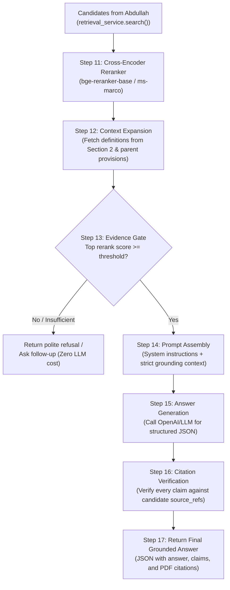

# LegalMind Phase B to Phase C Handover: Abdullah to Shimza

**Date:** 16 October 2026  
**Author:** Abdullah (Phase B Lead — Search Representation, Embeddings, Publications & First-Stage Retrieval)  
**Recipient:** Shimza (Phase C Lead — Reranking, Context Expansion, Evidence Gate, LLM Generation & Citation Verification)  
**Git Branch Baseline:** `feature/legal-embeddings` (Abdullah's branch)  
**Active Production Publication:** `legalmind-pilot-20261016` (23 statutory enactments, 531 source-ordered v2 chunks, all embedded)

---

> [!CAUTION]
> ### 🛑 CODE OWNERSHIP & PROTECTED BOUNDARIES (DO NOT TOUCH ABDULLAH'S CODE)
> 
> All files, models, migrations, and database tables created by **Abdullah** for **Phase B (Steps 6 to 10)** are **FROZEN, TESTED, AND PRODUCTION-ACTIVE**.
> 
> 1. **DO NOT modify, edit, or refactor any of Abdullah's files or logic** listed in Section 3 below.
> 2. **DO NOT alter database schema or write migrations affecting Phase B tables**:
>    - `chunk_sets`, `legal_chunks`, `legal_chunk_provisions`
>    - `embedding_profiles`, `legal_chunk_embeddings`
>    - `corpus_publications`, `publication_items`
>    - Existing indexes (`ix_legal_chunks_search_vector` GIN, `ix_lce_embedding_hnsw` HNSW, `ix_legal_chunks_chunk_set_label` B-Tree).
> 3. **DO NOT touch or change the embedding model**: `BAAI/bge-m3` (1024 dims, 8192 tokens) is already locked and generated for all 531 v2 chunks.
> 4. **Git Branching Rule**: Branch off Abdullah's branch (`feature/legal-embeddings`) into your own branch (e.g., `feature/phase-c-qa` or `shimza`). Never commit Phase C modifications directly inside Abdullah's files.
> 5. **Where Shimza Should Write Code**:
>    - Create **new separate files** for your work:
>      - `app/services/qa_reranker.py` (Step 11)
>      - `app/services/qa_context.py` (Step 12)
>      - `app/services/qa_evidence_gate.py` (Step 13)
>      - `app/services/qa_generation.py` (Steps 14–16)
>      - `app/schemas/qa.py` (Request & Response schemas for `/ask`)
>      - `app/api/routes/qa.py` (The `POST /ask` endpoint)
>      - `app/db/qa_models.py` (For `qa_runs`, `answer_claims`, `answer_evidence`)
>    - Consume Abdullah's retrieval engine strictly as an **external client/service**.

---

## 1. What Abdullah Did and Coded (Phase B: Steps 6 to 10)

Abdullah completed the full Phase B search and retrieval pipeline. Here is the exact inventory of what was built and what Abdullah owns:

### Complete Code Inventory Owned by Abdullah

```
app/
├── embeddings/                             <-- OWNED BY ABDULLAH (DO NOT TOUCH)
│   ├── __init__.py                         # Package exports
│   ├── profiles.py                         # BGE_M3 (1024 dim, 8192 tokens) & ACTIVE_PROFILE
│   ├── encoder.py                          # Singleton BGE-M3 loader & batch tokenizer/encoder
│   ├── models.py                           # EmbeddingProfileModel, LegalChunkEmbedding (Vector(1024))
│   └── repository.py                       # DB persistence & pgvector cosine similarity search
├── services/
│   ├── legal_chunking.py                   # OWNED BY ABDULLAH (v2 source-order chunker, 4k soft limit)
│   ├── legal_retrieval.py                  # OWNED BY ABDULLAH (LegalRetrievalService: query orchestrator)
│   ├── retrieval_fusion.py                 # OWNED BY ABDULLAH (Reciprocal Rank Fusion - RRF logic)
│   ├── legal_query.py                      # OWNED BY ABDULLAH (Legal reference & law parser)
│   ├── embedding_audit.py                  # OWNED BY ABDULLAH (Integrity & token audits)
│   └── corpus_validation.py                # OWNED BY ABDULLAH (Publication preflight validator)
├── repositories/
│   ├── legal_chunk_repository.py           # OWNED BY ABDULLAH (Chunk sets & provenance builder)
│   ├── publication_repository.py           # OWNED BY ABDULLAH (Publication manager & atomic activation)
│   └── legal_search_repository.py          # OWNED BY ABDULLAH (Exact citation, FTS, Vector DB joins)
├── schemas/
│   ├── legal_search.py                     # OWNED BY ABDULLAH (Input/Output schemas: LegalSearchOut)
│   └── publications.py                     # OWNED BY ABDULLAH (Publication schemas)
├── api/routes/
│   ├── legal_search.py                     # OWNED BY ABDULLAH (POST /search/legal)
│   └── publications.py                     # OWNED BY ABDULLAH (Publication admin routes)
└── db/
    └── publication_models.py               # OWNED BY ABDULLAH (CorpusPublication, PublicationItem)

alembic/versions/
├── 20261010_13_legal_chunking.py           # OWNED BY ABDULLAH
├── 20261010_14_legal_chunk_keyword_search.py # OWNED BY ABDULLAH
├── 20261013_15_chunk_source_segments.py    # OWNED BY ABDULLAH
├── 20261014_16_legal_embeddings.py         # OWNED BY ABDULLAH (pgvector + HNSW index)
└── 20261016_17_corpus_publications.py      # OWNED BY ABDULLAH (Publication tables)

scripts/
├── build_legal_chunks.py                   # OWNED BY ABDULLAH (Idempotent chunk builder)
├── build_legal_embeddings.py               # OWNED BY ABDULLAH (Idempotent BGE-M3 vector builder)
├── manage_publications.py                  # OWNED BY ABDULLAH (Plan, validate, activate publications)
├── search_legal.py                         # OWNED BY ABDULLAH (CLI search tool)
├── evaluate_legal_retrieval.py             # OWNED BY ABDULLAH (Benchmark test runner: 20/20 passed)
└── run_retrieval_tests.py                  # OWNED BY ABDULLAH (Quick 6-query test suite)
```

---

## 2. Summary of Abdullah's Completed Stages (Steps 6 to 10)

| Stage | What was built | Verified Result |
|---|---|---|
| **6. Create Chunks** | Pure, deterministic legal-aware v2 chunking (`legal-chunk-v2-source-order`). Groups text by Root Section/Rule/Article/Schedule. Preserves physical reading order so parent continuation text after child lists is strictly maintained. Soft 4,000-char budget. Excludes repealed/omitted laws. | **531 v2 chunks** across 23 approved enactments. Average: 798 chars, max: 3,969 chars (~1,016 tokens). Zero text loss. |
| **7. Keyword Index** | Generated column `search_vector = to_tsvector('english', search_text)` with a PostgreSQL GIN index (`ix_legal_chunks_search_vector`). Supports unstemmed label matching and phrase/stemmed search. | Bitmap Index Scan on GIN index executes in sub-millisecond warm DB time. |
| **8. Embeddings** | Dense vector representation using **`BAAI/bge-m3`** (1,024 dimensions, 8,192 max token budget). Normalised L2 embeddings. Indexed with pgvector HNSW cosine index (`ix_lce_embedding_hnsw`). | **100% of chunks embedded (531/531)** in `legal_chunk_embeddings`. Zero truncation. |
| **9. Publications** | Immutable publication snapshot system. Pins specific approved revision IDs, validates all checksums and chunk counts, and maintains a single `active` publication pointer with ACID rollback safety. | Active publication: **`legalmind-pilot-20261016`** (UUID: `3181ffc8-fa34-474a-a531-156928817d35`). |
| **10. Retrieval & RRF** | 3-way hybrid retrieval engine:<br>1. **Exact match**: Direct Section/Clause lookup (`find_by_label`, `find_by_reference_path`).<br>2. **Lexical**: PostgreSQL full-text search.<br>3. **Dense Vector**: Cosine similarity against `bge-m3`.<br>4. **Fusion**: Reciprocal Rank Fusion ($RRF = \frac{1}{60 + \text{rank}_{kw}} + \frac{1}{60 + \text{rank}_{vec}}$). | **20/20 test cases passed** in automated evaluation benchmark (`Hit@5 = 1.0`, `MRR@5 = 1.0`). |

---

## 3. How Shimza Must Use Abdullah's Retrieval Engine

Shimza does **not** need to query PostgreSQL `legal_chunks` or `legal_chunk_embeddings` directly. Abdullah provides two official integration interfaces:

### Option A: In-Process Python Call (Recommended for backend performance)

In your Phase C service (`app/services/qa_generation.py`), import Abdullah's service:

```python
from app.core.config import get_settings
from app.db.session import Database
from app.repositories.legal_search_repository import LegalSearchRepository
from app.services.legal_retrieval import LegalRetrievalService
from app.schemas.legal_search import LegalSearchIn

# 1. Initialize repository and service
db = Database(get_settings())
retrieval_service = LegalRetrievalService(LegalSearchRepository(db), get_settings())

# 2. Call retrieval with the user's question
search_request = LegalSearchIn(
    query="The shopkeeper refused to give me proof of purchase",
    limit=10,  # Return top 10 candidates for reranking
)
search_response = await retrieval_service.search(search_request)

# 3. Check status
if search_response.status == "no_results":
    # Immediately trigger Evidence Gate (no LLM call)
    return "I cannot find any relevant statutory provisions in the approved legal corpus."

if search_response.status == "needs_clarification":
    # User gave ambiguous reference like 'Section 19' without naming the Act
    return search_response.clarification_options

# 4. Extract candidates for your cross-encoder reranker
candidates = search_response.results
for candidate in candidates:
    print(f"Rank: {candidate.rank}")
    print(f"Act: {candidate.instrument_title}")
    print(f"Section/Rule: {candidate.label} - {candidate.heading}")
    print(f"Passage: {candidate.chunk_text}")
    print(f"Source PDF: {candidate.source_refs[0]['filename']} Page {candidate.source_refs[0]['page_index']}")
```

### Option B: HTTP API Call

If you prefer calling via HTTP:
- **URL**: `POST http://127.0.0.1:8000/search/legal`
- **Request Body**:
  ```json
  {
    "query": "The shopkeeper refused to give me proof of purchase",
    "limit": 10
  }
  ```

---

## 4. The Candidate Data Contract (What Shimza Receives)

Every candidate in `search_response.results` is a `LegalSearchResultItem` with the following fields:

| Field | Type | How Shimza Uses It |
|---|---|---|
| `chunk_id` | UUID | Unique identifier of the retrieved passage. Store in `retrieval_hits`. |
| `instrument_title` | str | Title of the law (e.g. *"The Punjab Consumer Protection Act 2005"*). |
| `label` | str | Section or Rule number (e.g. `"19"` or `"4"`). |
| `heading` | str | Title of the Section (e.g. *"Receipt to be issued to the purchaser"*). |
| `chunk_text` | str | **The full statutory text**. Feed this into your Cross-Encoder Reranker and LLM prompt context! |
| `exact_rank` | int \| None | **CRITICAL**: If `exact_rank == 1`, the user asked for a specific section (e.g. *"Section 19"*), and this is the verbatim statutory hit. **Do not demote exact hits during reranking!** |
| `rrf_rank` | int \| None | Rank from hybrid Lexical + BGE-M3 Vector fusion. |
| `rrf_score` | float | Reciprocal Rank Fusion score. |
| `source_refs` | list[dict] | **Your Citation Anchor**: Array containing physical PDF metadata: `filename` (e.g. `"477.pdf"`), `page_index` (physical page number), `source_span_id`, and `block_text_sha256`. Use this for Step 16 (Citation Verification). |

---

## 5. Shimza's Roadmap (Phase C: Steps 11 to 17)

Here is your exact development path according to the system architecture diagram:



### Step-by-Step Instructions for Shimza:

1. **Step 11 — Rerank Candidates**:
   - Take the top 10 candidates from Abdullah.
   - Run a Cross-Encoder (e.g., `cross-encoder/ms-marco-MiniLM-L-6-v2` or `BAAI/bge-reranker-base`) on `(query, candidate.chunk_text)` pairs.
   - Filter to the top 3–5 highest-scoring candidates.
   - *Golden Rule*: If `candidate.exact_rank == 1`, keep it at rank 1.
2. **Step 12 — Context Expansion**:
   - If a retrieved section uses defined terms, you can pull Section 2 (Definitions) of that Act using `instrument_id`.
   - Include parent chapter/heading context.
3. **Step 13 — Evidence Gate**:
   - If Abdullah returns `status: "no_results"` or if your top reranker score is below threshold, **stop immediately**.
   - Do not call OpenAI/LLM. Return: *"The provided legal database does not contain sufficient statutory basis to answer this question."*
4. **Step 14 & 15 — Build Prompt & Generate Answer**:
   - System prompt must enforce strict grounding: *"You are LegalMind AI. Answer strictly using the provided statutory passages. If the passages do not state the answer, state that the law does not provide for it. Cite section numbers."*
   - Generate structured JSON containing the answer broken down into individual claims.
5. **Step 16 — Citation Verification**:
   - For every claim made by the LLM, verify that the cited Section exists in the `source_refs` provided in the prompt.
   - If the LLM cited a section not present in the evidence, reject or redact the claim.
6. **Step 17 — Return Final Answer**:
   - Return clean JSON to user:
     ```json
     {
       "answer": "Under Section 19 of the Punjab Consumer Protection Act 2005, every seller must provide a receipt showing date, description, quantity, price, and seller name/address.",
       "citations": [
         {
           "law": "The Punjab Consumer Protection Act 2005",
           "section": "19",
           "source_pdf": "477.pdf",
           "page": 7
         }
       ]
     }
     ```

---

## 6. How to Verify Everything on Your Machine

To verify that Abdullah's active publication and retrieval work before writing Phase C code, run these 3 commands in PowerShell:

```powershell
# 1. Check active publication status
.\.venv\Scripts\python -m scripts.manage_publications list

# 2. Run the 6-query retrieval test suite
.\.venv\Scripts\python -m scripts.run_retrieval_tests

# 3. Run all backend tests
.\.venv\Scripts\pytest -q
```

---

## 7. Handover Agreement

- **Abdullah's Promise**: Phase B code and output schema (`LegalSearchOut`, `LegalSearchResultItem`) are frozen and stable.
- **Shimza's Promise**: Shimza works in a separate branch, does not alter Abdullah's files, and builds Phase C on top of `LegalRetrievalService`.
- **Parallel Work**: While Shimza implements Phase C, Abdullah will continue stress-testing edge cases and monitoring database performance. If any publication changes occur, Abdullah will coordinate with Shimza.
