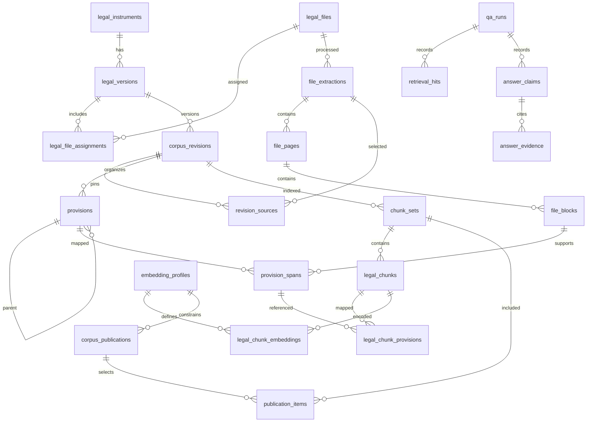

> Historical report from 11 November 2026. See [the 14 November implemented architecture and validation review](LEGALMIND_REVIEW_2026-11-14.md) for the current answer pipeline.

# LegalMind complete system architecture and stage guide

Audit date **11 November 2026**. The starting backend was `feature/ask` at
`4026c8b`. The live pilot release was `legalmind-pilot-20261016`.
See the [database audit](DATABASE_DATA_QUALITY_AUDIT.md) and
[benchmark report](LEGALMIND_RAG_TESTING_AND_BENCHMARK_REPORT.md) for measured results.

## Architecture assessment

The supplied image correctly divides the work into offline corpus preparation
(Haroon), offline search preparation and online candidate retrieval (Abdullah),
and online evidence selection and answering (Shimza). The running backend
differs in these details.

| Image | Actual implementation and audit decision |
| --- | --- |
| Upload, OCR, store pages, structure, review | Upload registers an immutable SHA-256 PDF and a durable job. Separate extraction and structure workers pin extraction IDs. Physical pages and text blocks have independent outcomes, spans and review coverage. Existing source-order and review controls were preserved. |
| One table called `chunk_embeddings`, MiniLM optional | `legal_chunk_embeddings` stores 1024-wide, L2-normalized BGE-M3 vectors. The active release uses source-ordered v2 chunks. Historical v1 chunks had 18 confirmed ordering defects and no active vectors. The change keeps the v2 release and compares models in isolated spaces. |
| Validated publication then FTS, vector search and RRF | An active release is an explicit list of revision/chunk-set/profile identities. Retrieval now batches catalog checks, preserves the original query, adds a separate bounded lexical variant, and handles several numbered provisions within a single selected law. PostgreSQL can choose a conventional index plus sort for the small pilot despite available GIN and HNSW indexes. |
| Cross-encoder, expansion, then evidence gate | A cross-encoder reranks conceptual candidates. Resolved exact lookups use their verified order directly. Before building the context graph, the pipeline filters roots for relevance so a weak hit cannot consume the budget or introduce a missing dependency for a stronger hit. The final gate still checks source identity, coverage and required dependencies. |
| OpenAI prompt and response | The branch had both OpenAI and Gemini adapters and auto-selection. The local environment has an OpenAI configuration and lacks a Gemini key. The sample deployment configuration selects Gemini explicitly. The Gemini adapter uses the header credential, structured JSON and its own limits, with a configurable stable Flash-Lite default. OpenAI remains a supported explicit choice. |
| Verify citations, store audit, return JSON | The verifier independently maps each exact quote to stored PDF block spans in a fresh active-publication snapshot. It enforces requested subsection coverage and partial status for missing exact references. Audit tables are optional, absent from the shared database, and protected by a new unapplied RLS migration. |

```mermaid
flowchart LR
    subgraph A["A · Prepare source data"]
      PDF["Original PDF"] --> UP["Hash and register"]
      UP --> EX["Page extraction and OCR"]
      EX --> ST["Blocks, provisions and spans"]
      ST --> REV["Human review and approved revision"]
    end
    subgraph B["B · Publish and retrieve"]
      REV --> CH["Source-ordered chunk set"]
      CH --> FTS["English FTS"]
      CH --> EMB["BGE-M3 embeddings"]
      FTS --> PUB["Validated active publication"]
      EMB --> PUB
      Q["POST /search/legal or /ask"] --> N["Original query, legal scope and optional variant"]
      N --> RET["Exact lookup or FTS + cosine + RRF"]
      PUB --> RET
    end
    subgraph C["C · Prepare and answer"]
      RET --> RN["Cross-encoder for conceptual results"]
      RN --> CX["Relevant roots and required context"]
      CX --> G["Evidence gate"]
      G -->|Supported or partial| L["Gemini structured draft"]
      G -->|Unclear, weak or unavailable| OUT["Typed API response"]
      L --> V["Fresh quotation and page-span verification"]
      V --> OUT
    end
```

## Phase A · Source to reviewed revision

| Stage | Input, algorithm and output | Implementation, controls and verification |
| --- | --- | --- |
| 1. Upload | A PDF plus instrument, jurisdiction and edition metadata becomes a content-addressed original and an extraction job. The byte hash and physical page count are recorded before registration. | `api/routes/legal_ingestion.py`, `services/legal_upload.py::store_legal_pdf`, `repositories/legal_ingestion_repository.py::register_upload`. `legal_files`, `legal_file_assignments`, `legal_versions`, `processing_jobs`. Loopback development plus `LEGAL_INGEST_ENABLED`, 100 MB and 2,000 pages by default. Conflicting metadata and invalid PDFs are rejected. `test_legal_upload.py`, `test_legal_ingestion_api.py`. |
| 2. Extract | The worker claims the job, rechecks source identity and visits every physical page. PyMuPDF native extraction is preferred, with Tesseract OCR for eligible pages. Failed/ambiguous pages carry an outcome and warnings for review. | `workers/legal_extract.py::process_one`, `services/legal_extraction.py::extract_page`. `file_extractions`, `file_pages`, `job_attempts`. `LEGAL_OCR_TESSDATA_DIR`, `LEGAL_OCR_LANGUAGES=eng`, `LEGAL_OCR_DPI=200`. `test_legal_extraction.py`, `test_legal_extraction_repository.py`. The legacy inspector worker uses a separate repository and PDF subprocess path. |
| 3. Preprocess | Native/OCR blocks keep raw and normalized text, bounding boxes, positions, table regions and warnings. Reviewed edits are explicit. The PDF bytes stay available for inspection. | `services/legal_extraction.py::_build_blocks`, `_table_regions`, `apply_reviewed_edits`. `file_pages`, `file_blocks`. Missing blocks or mismatched offsets are detected by the persistence audit and structure coverage. `test_legal_reviewed_extraction.py`, `test_legal_extraction.py`. |
| 4. Parse legal structure | Ordered blocks and instrument type feed a deterministic parser for Parts, Chapters, Sections, Rules, Schedules, nested lists, notes and amendments. The parser records what each block contributed. | `workers/legal_structure.py::process_one`, `services/legal_structure.py::parse_structure`, parser `legal-structure-v12` for new parses. `corpus_revisions`, `revision_sources`, `revision_block_coverage`. Input changes produce another revision. Structure and parser regression suites cover layout variants, headings, schedules and ownership. |
| 5. Map page and block | A half-open range in a provision maps to a half-open range in a normalized block on a 1-based physical page. The revision pins the extraction ID, so a subsequent OCR run cannot move a historical citation. | `services/legal_structure.py` emits `DraftSpan`. `repositories/legal_structure_repository.py` persists `provision_spans` and `revision_sources`. Exact text and offset equality are checked during audits, chunk validation and quote verification. `test_legal_audit.py`, `test_legal_structure_audit_regressions.py`. |
| 6. Save and approve provisions | Provisions retain path, label, parent, ordinal, own text and source status. Review checks page outcomes, source coverage, ambiguities and non-operative provisions before approval. | `repositories/legal_structure_repository.py`, `services/legal_audit.py`, `api/routes/legal_ingestion.py`. `provisions`, `provision_references`, `source_note_marker_links`, `review_events`. Review gate is local admin. `test_legal_approval_api.py`, `test_legal_source_status.py`. Approval selects the extraction for search use. All 23 editions still have unknown applicability. |

Contract uploads are a separate workflow. `POST /contracts` validates a
selectable-text PDF (10 MB and 10 pages by default), saves it under a generated
ID and registers a version. Extraction via `scripts/extract_contract.py` and
Docling populates `contract_pages`, `contract_clauses` and
`contract_clause_spans`. `GET /contracts/{document_id}` reads upload metadata.
Both routes are now loopback-development-only because the schema and UI lack
ownership checks. An uncertain database commit retains the original PDF for
reconciliation. Statutory `/ask` searches publication membership and has no
path into contract records.

## Phase B · Index and publish

| Stage | Input, algorithm and output | Implementation, controls and verification |
| --- | --- | --- |
| 7. Chunk | A reviewed revision becomes `legal-chunk-v2-source-order` chunks. One operative root usually produces one chunk. The 4,000-character soft limit splits long roots at exact source fragments. Each chunk stores sequence, parent root, display heading and exact source offsets. | `services/legal_chunking.py::build_chunks_from_spans`, `repositories/legal_chunk_repository.py::build_for_revision`. `chunk_sets`, `legal_chunks`, `legal_chunk_provisions`. Identity includes revision, content and config hash. `test_legal_chunking_source_order.py`, `scripts.audit_legal_chunks_readonly`. |
| 8. Count tokens | The actual BGE tokenizer counts the full input including special tokens. The v1 recipe also rejects inputs beyond its historical 24,576-character compatibility ceiling. | `embeddings/encoder.py::build_embedding_input` and `check_token_lengths`. `services/embedding_audit.py::audit_embeddings`. Oversized inputs are rejected before encoding. `test_embeddings.py` and `scripts.audit_legal_embeddings --check-tokens`. The live maximum was 1,016 tokens. |
| 9. Encode | Sentence Transformers loads `BAAI/bge-m3` once per process and computes 1,024 normalized components from title, label, heading and complete chunk text. Inference on the shared model is serialized. | `embeddings/profiles.py::BGE_M3`, `embeddings/encoder.py::encode_texts`. Profile `bge-m3-v1`, 8,192-token input. `scripts.build_legal_embeddings` batches the work. Wrong dimension, non-finite vectors and wrong norms are rejected. |
| 10. Store and publish | The embedding builder upserts only missing/stale/invalid vectors. Publication validation rebuilds chunk identity and verifies its vectors and approval. Activation atomically selects one immutable release. | `embeddings/repository.py::upsert_embeddings`, `services/corpus_validation.py::validate_corpus`, `repositories/publication_repository.py::activate`. `embedding_profiles`, `legal_chunk_embeddings`, `corpus_publications`, `publication_items`. Active pgvector cosine HNSW is `m=16`, `ef_construction=64`. `test_publication_safety.py`, `scripts.manage_publications validate`. |

Fixed-size and recursive character splitting can break conditions or add
ambiguous overlaps. Token windows are useful for comparing short-window models,
but do not establish legal boundaries. The production representation is the
existing source-ordered v2 strategy with root expansion and **zero intentional
text overlap**. Four live roots have multiple parts. The chunker keeps source
order even when a parent's text continues after its children. It still depends
on Phase A to get the hierarchy and operative status right. A model or text
recipe change needs a new profile, isolated compatible vectors and an explicit
new publication. A dimensional change also needs a compatible schema and index.

## Phase C · Question to response

| Stage | Input, algorithm and output | Implementation, controls and verification |
| --- | --- | --- |
| 11. Normalize | Validate lengths and meaningful characters. Apply Unicode compatibility normalization and whitespace normalization for lookup while keeping the original question in the response. Parse supplied or numbered references and resolve law names within the active catalog. | `schemas/legal_search.py`, `schemas/qa.py`, `services/legal_query.py::prepare_query`, `resolve_laws`. Search accepts 1–4,000 characters, ask 3–4,000 including the bounded follow-up. Exact identifiers distinguish 19, 19A and 19(1). `test_legal_retrieval.py`, `test_qa_answer.py`. |
| 12. Create alternatives | One bounded variant uses legal vocabulary, unique simple edit candidates, known misspellings and plain-language aliases. Original and variant keywords are independent PostgreSQL inputs. Title spelling may be repaired only after the original title lookup fails, with years preserved. A new numbered reference takes priority over the earlier follow-up reference. | `services/legal_query.py::query_alternative`. Rewriting is local. Exact multi-reference support handles up to four individually named addresses for one selected law. Ranges, ambiguous shorthand and conflicting laws require clarification. |
| 13. Embed the query | Encode the normalized original with the publication's BGE profile. A changed variant can be encoded on a bounded fallback. An exact lookup skips embedding. | `services/legal_retrieval.py::_query_vector`, `embeddings/encoder.py::encode_texts_async`. The lexical channel can still return results on encoder failure. With neither semantic availability nor keyword candidates, return a service error. |
| 14. Search vectors | Publication-pinned cosine similarity is `1 - (embedding <=> query_vector)`. Filter by legal scope and the existing minimum 0.48. The repository requests iterative HNSW scans and `ef_search=200`. | `repositories/legal_search_repository.py::retrieve`. All inputs use bound parameters. `LEGAL_SEARCH_MIN_SIMILARITY`, `LEGAL_SEARCH_HNSW_EF_SEARCH`, `LEGAL_SEARCH_CANDIDATE_POOL=50`. Actual plans appear in the database audit. |
| 15. Search text | Stored English `tsvector` covers the act name, legal label, heading and body. The query builds phrase, strict AND and relaxed OR forms with stemming. Phrase, strict match, lexeme coverage and `ts_rank_cd` order results. | `services/legal_chunking.py::build_search_text`, migration `20261010_14`, `legal_search_repository.py`. GIN on `search_vector`. Relaxed keyword hits require dense support or independently strong lexical coverage if the keyword channel would be empty. `test_legal_chunk_search_schema.py`, `test_legal_retrieval.py`. |
| 16. Scope and fallback | An exact lookup walks numbered root and child identities. Conceptual lookup combines lexical and vector lists scoped to the same approved publication. A scoped empty pass can expand to 100 candidates. A materially different variant can retry after weak original results. | `services/legal_retrieval.py`, `repositories/legal_search_repository.py`. Publication changes are retried once and outputs never mix publications. Explicit unavailable laws/references cannot fall back to unrelated sections. `test_publication_safety.py` and real API benchmark. |
| 17. Fuse ranks | Deduplicate each channel by chunk ID and sum `1 / (k + rank)` across present channels. Higher score wins. Ties use dense score, lexical score, then stable ID. | `services/retrieval_fusion.py::reciprocal_rank_fusion`, `LEGAL_SEARCH_RRF_K=60`. Keyword and vector score magnitudes are never added. Raw ranks remain visible. |
| 18. Rerank | `/ask` takes up to 10 Stage B candidates. `BAAI/bge-reranker-v2-m3` scores full question/passage pairs and keeps up to eight conceptual candidates. Exact ranks bypass the model and carry no fabricated score. | `services/qa_reranker.py::CandidateReranker`. `QA_RERANK_TOP_K=8`, CPU, FP32, batch size 4, pair budget 8,192. Missing cache, non-finite scores and oversized pairs fail explicitly. `test_qa_reranker.py`. |
| 19. Select and gate | Keep exact roots, roots with dense retrieval plus a positive cross-encoder logit, or roots with direct topic-word overlap in the passage body. Fragments of the same root can supply that overlap. Then verify exact provenance, version agreement, retained candidates and required expansion. | `services/qa_preparation.py`, `services/qa_evidence_gate.py::relevance_by_root`, `EvidenceGate.decide`. These are screening signals, not calibrated legal confidence. Weak evidence, absent evidence, ambiguity, missing requested references and technical failure have separate internal handling. `test_qa_evidence_gate.py`, `test_qa_gate_safety.py`. |
| 20. Build context | Selected candidates expand to complete root siblings, parents, qualifications and verified same-publication references. For numbered lookups, heading-discovered optional definitions are added only for definition questions. Required groups get the budget first. | `services/qa_context.py`, `qa_references.py`, `qa_context_scope.py`, `repositories/qa_context_repository.py`. Defaults 20 units, 32,000 characters, 6,000 local tokenizer tokens, reference depth 2, up to two optional definitions per law. Required missing groups block generation. Optional incomplete groups roll back atomically. `test_qa_context*.py`. |
| 21. Call Gemini | Assemble a system instruction and a bounded JSON packet with the question, resolved context, publication, evidence IDs, exact text, edition, source pages and requested reference paths. Send `generateContent` over TLS with an API key header. | `services/qa_prompt.py::build_prompt` (128 KiB limit), `services/qa_generation.py::AnswerGenerator`. `LLM_PROVIDER=gemini`, `GEMINI_API_KEY`, `GEMINI_MODEL=gemini-3.1-flash-lite`, 35 s generation deadline and 1,200 output tokens. Optional thinking level is model-specific. One connect-only retry. [Gemini API reference](https://aistudio.google.com/api-reference/generate-content), [model card](https://aistudio.google.com/docs/models/gemini-3.1-flash-lite). |
| 22. Validate draft | Accept only a completed structured response. The model chooses an outcome and exact quotes keyed by supplied IDs. It must account for qualifiers and missing information. Free-form draft answers are discarded. | `schemas/qa_generation.py::AnswerDraft`, `services/qa_answer.py`. HTTP errors, timeouts, blocked or incomplete results and JSON/schema errors return a service failure. `test_qa_generation_gemini.py`, `test_qa_generation_sdk.py`. |
| 23. Verify citations | Resolve quote boundaries in the supplied passage. Re-read the pinned source and verify the quote's character ranges against provision and normalized PDF block spans. Build file, hash, edition, label, path, page and claim index on the server. A complete exact answer must cite every requested path or its descendants. | `services/qa_citations.py::CitationVerifier`, `services/qa_source_verification.py::verify_many`, `qa_source_proofs.py`. Default one repair for invalid citations. No provider retry for database verification failure. `test_qa_citation_safety.py`, `test_qa_source_verification.py`. |
| 24. Return result | `/ask` assembles its answer from verified quotes and emits `answered`, `partial`, `clarification_needed`, `insufficient_evidence` or `service_unavailable`. Citations retain their immutable evidence, publication, version and span identities. | `api/routes/qa.py`, `schemas/qa.py::AskOut`. 503 is reserved for service failure, 422 for invalid input, 404 if search is disabled. `/search/legal` also has a typed 503. The existing frontend schema accepts the same `/ask` fields and statuses. |

The relevance screen runs before expensive expansion. The final evidence gate
runs **after** expansion, so a strong rank cannot bypass a broken or incomplete
source mapping. If only some exact references exist, the generator can quote
supported material as partial and the server supplies the missing-reference
notice. For a conceptual question, if several relevant roots cannot be
expanded together, one retry can retain the highest-ranked root with direct
topic coverage and its complete dependencies. That path can return only a
partial answer or abstention. When no usable evidence remains, `/ask` avoids
provider generation.
The optional server fact provider only uses reviewed rules with cited conditions.

## Deployment and operating checks

1. Install Python 3.12+, backend requirements and the cached model weights.
   Set `DATABASE_URL` and `DB_SSL` in the ignored backend environment file.
   The default connection pool is 5 plus up to 5 overflow, with pre-ping,
   30 s checkout and 1,800 s recycle. Request budgets default to 90 s for
   search and 180 s for ask, within the current frontend's 240 s timeout.
2. Use the same app version, profile and pgvector extension for validation and
   serving. In development, keep contract and legal-admin access on loopback.
   In a hosted deployment, use `ENVIRONMENT=production`, approved
   `CORS_ORIGINS`, explicit gateway rate limits and a restricted server database
   role. Provision reviewed corpus files separately if administrators need page previews.
3. Keep `QA_RECORD_RUNS=false` unless retaining questions is a deliberate
   deployment decision. The shared DB is at Alembic `20261016_17`. For
   optional recording, review a backup and apply `20261017_18` and
   `20261111_19` together on the intended database. Only the authorized
   server-side writer should be able to access the records. Rolling back app
   code can leave the RLS migration in place.
4. Enable `LEGAL_SEARCH_ENABLED=true` only with a validated active publication.
   Configure the Gemini key and model for answers. Run `uvicorn app.main:app`
   and check `GET /health`, an exact `POST /search/legal`, and supported and
   unsupported `POST /ask` cases. The legacy 30-section index is retired.
5. Run `python -m pytest -q`, the database audit and the baseline/improved
   benchmark described in the companion reports. Monitor stage logs for
   embedding, lexical and vector candidate counts, reranking, context issues,
   gate decisions, Gemini usage, citation checks and total latency. Logs use
   stage names, counts, error types and timings rather than source passages,
   questions or credentials.

## Remaining limitations

- The active publication has 23 pilot instruments. Contract Act 1872 is
  absent, so consent, coercion and fraud prompts cannot be answered by
  citing a different Act's section 19. New coverage requires a reviewed PDF
  and a validated new publication.
- Citation verification proves the quoted characters and source locations.
  Legal applicability, completeness of a legal interpretation, and
  cherry-picking of a legitimate quote still need domain review. Missing fact
  questions and model-identified information gaps are not verified claims.
- Unreviewed cross-law links, unsupported shorthand and missing mandatory
  context cause clarification or abstention. The small evaluation provides
  limited evidence about Roman Urdu, unseen statutes or open-ended legal
  comparisons. No LLM-based rewriting, new model profile, or automatic
  deployment was introduced.
- The development database connection bypasses RLS. All existing audited
  tables have RLS and no policies, but production still needs explicit
  least-privilege server roles and a reviewed data-retention policy.
- Timings depend on host-to-Supabase round trips, model hardware and provider
  quotas. Native inference already in flight can finish after cancellation.
  A same-region database and measured workload concurrency are part of the
  deployment check. Live Gemini answer quality requires its backend credential.
