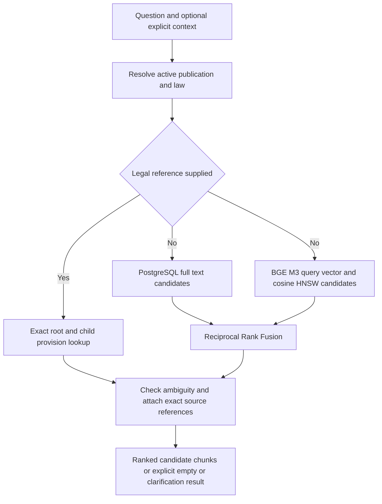

# LegalMind publication and first stage retrieval

Implementation review and Windows PowerShell runbook for the backend on
`feature/legal-embeddings`, starting from commit `e2a4424`.

This document explains the existing pipeline, the embedding audit, the additions
for Stage 9 and Stage 10, and how to operate them. Search returns source-backed
candidate chunks. Answer generation and a second-stage reranker remain outside
this implementation.

## What I inspected before changing the application

I read the backend README, requirements, settings, database/session layer,
Alembic migration chain, legal corpus and embedding models, the chunking and
embedding builders, the existing keyword/vector repositories, source-reference
mapping, approval workflow, API dependencies/routes, existing tests, and the
Phase B and chunk/keyword handover documents. I also ran the original test suite
and queried the configured PostgreSQL database read-only.

The original pipeline was:

1. Register a legal instrument, legal edition, and immutable PDF.
2. Extract physical pages and ordered blocks.
3. Save a structured corpus revision and exact provision source spans.
4. Record a local approval decision.
5. Build an immutable chunk set pinned to the approved revision hash.
6. Generate the PostgreSQL full-text vector and its GIN index.
7. Store BGE-M3 vectors by chunk and embedding profile, with an HNSW index.

The database had no `corpus_publications` or `publication_items` tables. Existing
repository search methods were internal diagnostics over approved chunk sets;
they did not establish a deliberately published search corpus. The old `/ask`
prototype was retired and remains retired.

## Embedding audit findings

| Check | Observed result before publication work |
|---|---|
| Database migration | `20261014_16` |
| PostgreSQL | 17.6 |
| pgvector | 0.8.2 |
| Active profile | `bge-m3-v1` |
| Model | `BAAI/bge-m3` |
| Dense dimensions | 1,024 in the profile, vector column, and all existing vectors |
| Configured token budget | 8,192, including special tokens |
| Current source-order chunk sets | 23 |
| Current chunks and vectors | 531 chunks and 531 vectors |
| Historical v1 chunks | 529, retained without backfilling unused vectors |
| Missing or stale current vectors | 0 |
| Wrong chunk hashes or character counts | 0 |
| Longest assembled input | 4,041 characters and 1,016 actual tokenizer tokens |
| Vector L2 norms | Approximately 0.9999998903 to 1.0000001640 |
| Existing GIN and cosine HNSW indexes | Present, ready, and valid |
| Baseline tests | 242 passed |

The legacy `embedding_dim=384` setting belongs to retired migrations; it is not
the active model dimension and was left intact for migration compatibility.

The stored input hashes match the existing text recipe. That recipe prepends a
title, label, and heading even though the chunk text already contains a display
prefix. I preserved that recipe so valid existing vectors remain compatible.
Removing the repeated prefix would require a deliberately new profile and an
evaluated rebuild; it was not necessary for this task.

The old character truncation path did not affect any current input. However,
`max_tokens * 3` characters cannot guarantee a tokenizer budget. The encoder now
rejects an input that would cross that historical character ceiling and checks
the actual token count before encoding. It does not silently discard legal text.

The historical profile records the model ID, not the exact weights commit,
runtime library versions, or original tokenizer artifact. An input hash cannot
prove the origin of a vector. The optional model calibration command compares a
small sample in memory without overwriting stored vectors. Its measured result
is recorded with the final verification evidence.

## Verified weaknesses corrected

- Profile reuse originally compared only dimensions. It now checks name, model
  ID, dimensions, token budget, text recipe, and normalization. Profile creation
  uses a conflict-safe insert, so simultaneous calls cannot create duplicates.
- The builder originally fetched only missing rows. It now also detects stale
  input hashes and invalid vector normalization, and repairs only those rows.
- Repeating an upsert for an already valid input is a database no-op. Valid
  vectors and their original timestamps remain intact. Healthy rows are skipped
  before INSERT, so retries also work after publication protection is installed.
- The encoder checks finite values, dimensions, nonzero length, normalization,
  output count, and actual token lengths. Loading no longer enables arbitrary
  remote model code.
- Encoder caching uses the complete immutable profile as its key. Two
  configurations cannot silently share an encoder because they reused a name.
- Audit, dry-run, and retrieval profile lookups do not insert profile rows.
- Existing HNSW/B-tree indexes are now represented in ORM metadata, matching the
  migration and avoiding misleading future autogenerate removals.
- An explicit empty revision filter in the internal vector repository now means
  no selected revisions rather than an unfiltered corpus.
- The existing vector diagnostic used a vector-typed distance expression that
  attempted to bind the numeric score constant as a vector. It now uses the
  typed cosine comparator and returns numeric scores correctly.
- Database commands have a configurable 120-second client timeout, bounding a
  stalled network/query wait. Existing connect, pool, and startup behavior stays
  in the existing database layer.
- Validation and snapshots read corpus rows in bounded transport batches. The
  configured pooler exposed an unnamed prepared-statement parameter collision
  during a live read; application and Alembic connections now use unique names
  while keeping both existing statement caches disabled.
- The declared sentence-transformers range now accepts the already installed
  5.7.0 runtime while retaining support for the existing 3.x API. No new runtime
  package was added. `pip check` passed in the working environment.

## Stage 9 publication lifecycle

`corpus_publications` records a name, embedding profile, sealed manifest hash,
validation report, total chunk count, lifecycle status, and timestamps.
`publication_items` selects a precise chunk set, revision, edition, instrument,
revision hash, and expected chunk count. One publication selects one revision
and edition per instrument. It never silently selects the latest revision.

Creation requires an explicit list of chunk-set IDs. Validation checks:

1. Every selected chunk set exists and uses the supported source-order
   chunker/config fingerprint.
2. Every revision has a recorded approval and a matching pinned content hash.
3. Selected source extractions are complete and have the expected physical page
   rows. Exact source text must match the saved PDF block ranges.
4. The existing pure chunker reproduces all stored chunks from their approved
   provision text and source spans. Text, labels, headings, ordering, hashes,
   split-part metadata, search text, and fragment membership must match. This
   comparison writes no chunks and computes no replacement vectors.
5. Every chunk has the expected current-profile input hash and a healthy vector.
   Token limits and the existing GIN/HNSW indexes are checked too.

Only a complete validated publication is sealed as `ready`. Activation repeats
validation and compares the sealed manifest before making any change to the
previous active publication. A transaction-scoped advisory lock serializes
publication changes within its database schema; a partial unique index allows at
most one active row. A concurrent operation receives a clear busy conflict and
can retry after the first operation finishes.
Retiring the old publication and activating the new one commit together.

A short SHARE lock prevents corpus mutation between validation and sealing.
Tokenizers are warmed before acquiring that lock. Ordinary SELECT/search remains
available. Lock waits fail after five seconds; a failed activation rolls back.

Database guards seal publication membership and protect the published chunk set,
its vectors/profile, and referenced source records. New independent revisions,
chunk sets, and embedding profiles remain possible. A published snapshot is
retained for history rather than overwritten. Approval revocation is allowed;
search detects it and refuses the now incomplete active release. A previous
publication can be explicitly reactivated only if it still passes validation.

The existing local approvals are development handoff decisions with review
exceptions, not certification of current legal applicability. Publications carry
the approval IDs/timestamps and each edition's applicability status. The new
administration routes reuse the existing development/loopback gate. They do not
introduce a public unauthenticated publication-management endpoint.

## Stage 10 retrieval flow



Every branch uses the same SQL allow-list join through the active publication's
items. It also checks approval state, revision hashes, and the pinned embedding
profile. A client cannot submit arbitrary revision IDs. A request uses one
repeatable-read database snapshot. If activation changes the publication while
a query vector is being prepared, preparation is retried once for the new
publication; candidates from two releases are never mixed.

Exact lookup handles Section, Rule, Article, and Schedule references, including
child labels such as `4(2)(a)`. It follows stored parent-child relationships and
actual source-fragment membership. `19` does not match `19A`. Missing exact
references return no results. Cross-law or duplicate-source matches return
clarification options instead of arbitrarily choosing a provision.

FTS reuses `legal_chunks.search_vector` and the existing GIN index. Strict
lexical matches lead; relaxed matches are ranked by distinct query-term coverage
before term frequency. A weak OR match must also clear the semantic similarity
threshold. Lexical-only fallback requires strong term coverage. This prevents
common-word overlap from manufacturing results for unrelated questions. Query vectors use the same active
embedding profile as the publication. Vector lookup orders directly by pgvector
cosine distance so PostgreSQL can use the existing HNSW index. Filtered HNSW
search uses `hnsw.iterative_scan=strict_order` and an `ef_search` of 200.
PostgreSQL may reasonably choose an exact scan for this small corpus; the
implementation does not force an index plan in production.

For hybrid retrieval, each candidate receives:

`RRF score = 1 / (60 + keyword rank) + 1 / (60 + vector rank)`

A missing branch contributes zero. Raw FTS and cosine scores are not directly
added. Results expose keyword, vector, and RRF ranks/scores. Exact lookup exposes
its exact rank and leaves unused hybrid ranks null. Scores are retrieval signals,
not confidence that a legal claim is correct.

Each candidate contains the actual instrument/edition, revision and chunk IDs,
root reference, matched child reference paths, text, split-part metadata, and
ordered source references with PDF identity, source URL, page, block, provision,
and character ranges. Private filesystem object keys are not returned.

Source-fragment payloads are loaded only for the candidates selected for return,
after fusion and within the same publication snapshot. Candidate-pool scoring
therefore does not fetch detailed PDF metadata for every discarded neighbor.

Follow-up context is explicit input: an earlier question and/or selected law or
instrument. It is used only for detected follow-ups and is disclosed through
`retrieval_query` and `context_used`. The system does not invent case facts or
retrieve some other user's history. A new explicit law overrides contextual law
selection. Insufficient reference context produces clarification.

Unrelated questions can return `no_results`; the vector similarity threshold is
configurable and is evaluated with negative examples. If semantic encoding is
unavailable, lexical candidates may still be returned with an explicit warning.
The evaluation runner treats such fallback as incomplete semantic verification.

## Files and responsibilities

| Files | Purpose |
|---|---|
| `app/embeddings/encoder.py`, `profiles.py`, `repository.py`, `models.py` | Encoding safety, complete profile identity, selective repairs, existing index metadata |
| `app/services/embedding_audit.py` | Shared read-only embedding and index health audit |
| `app/services/corpus_validation.py` | Approved-source reproduction and complete-publication validation |
| `app/db/publication_models.py` | Publication and membership ORM models |
| `app/repositories/publication_repository.py` | Explicit creation, sealing, atomic activation, listing |
| `app/repositories/legal_search_repository.py` | Active-publication exact, FTS, vector, and source reads |
| `app/services/legal_query.py`, `legal_retrieval.py` | Reference/law/context resolution and RRF orchestration |
| `app/services/retrieval_fusion.py` | Shared RRF implementation for final-candidate source selection and output ranking |
| `app/schemas/legal_search.py`, `publications.py` | Validated API input and output contracts |
| `app/api/routes/legal_search.py`, `publications.py` | Search and existing-gate local administration routes |
| `app/repositories/legal_chunk_repository.py` | Reused provenance mapping with additional source metadata |
| `app/core/config.py`, `app/db/session.py`, `app/main.py`, `.env.example` | Settings, bounded query wait, route registration |
| `app/db/streaming.py` | Batched corpus reads within the existing caller transaction |
| `alembic/env.py`, `alembic/versions/20261016_17_corpus_publications.py` | Model registration and the single additive migration |
| `scripts/audit_legal_embeddings.py`, `backup_retrieval_state.py` | Operator audit/calibration and private safety snapshot |
| `scripts/manage_publications.py`, `search_legal.py` | Publication and retrieval operator commands |
| `scripts/build_legal_embeddings.py` | Read-only dry-run and selective missing/stale repairs |
| `scripts/test_vector_search_readonly.py` | Clarifies the internal diagnostic versus the publication-scoped CLI |
| `scripts/verify_publication_retrieval.py` | Opt-in disposable-schema PostgreSQL integration checks |
| `scripts/evaluate_legal_retrieval.py`, `data/retrieval_evaluation.json` | Representative pilot questions, negative cases, hit/rank measurements |
| `tests/test_embeddings.py`, `test_legal_retrieval.py`, `test_legal_search_api.py`, `test_publication_safety.py` | Unit/service/API regression coverage |
| `requirements.txt`, `README.md`, this document | Runtime compatibility and operator documentation |

## Windows PowerShell runbook

Run these commands from a PowerShell window. Keep the existing private `.env`;
do not overwrite it with `.env.example`. The configured database is shared by the
team, so coordinate migrations with other backend work.

### Select the existing environment

```powershell
Set-Location 'C:\Users\Admin\Desktop\FYP\legalmind-backend' -ErrorAction Stop
$py = '.\.venv\Scripts\python.exe'
& $py -m pip check
if ($LASTEXITCODE -ne 0) { throw 'Resolve the reported environment conflicts first.' }
```

If this is a fresh checkout with no environment, use `py -3 -m venv .venv` and
`& $py -m pip install -r requirements-dev.txt` first. The existing environment
already contains the required dependencies.

### Audit before touching vectors

```powershell
& $py -m scripts.audit_legal_embeddings --check-tokens --output backups\embedding-audit-before.json
if ($LASTEXITCODE -ne 0) { throw 'Embedding audit failed; inspect the report.' }

# Optional model calibration. This loads weights and computes only in-memory probes.
& $py -m scripts.audit_legal_embeddings --check-tokens --verify-model-sample 3 --output backups\embedding-model-probe.json
if ($LASTEXITCODE -ne 0) { throw 'Model calibration failed; inspect the report before changing vectors.' }

# This dry-run never creates profiles or writes embeddings.
& $py -m scripts.build_legal_embeddings --dry-run
```

If the audit identifies actual missing/stale vectors, the existing builder can
repair them with `& $py -m scripts.build_legal_embeddings`. It skips valid rows.
For a single revision use `--revision-id` with its real UUID. Oversized inputs
require a new validated chunk set; they are not silently truncated. Published
data is protected, so a changed published source/model needs a new revision or
profile and publication rather than an overwrite.

### Snapshot and migrate safely

```powershell
& $py -m scripts.backup_retrieval_state
if ($LASTEXITCODE -ne 0) { throw 'Snapshot failed; do not continue.' }

& $py -m alembic current
if ($LASTEXITCODE -ne 0) { throw 'Cannot read the current migration.' }

# Inspect the additive Stage 9 SQL. This command does not execute it.
& $py -m alembic upgrade 20261014_16:head --sql |
    Set-Content -LiteralPath backups\publication-upgrade.sql -Encoding UTF8
if ($LASTEXITCODE -ne 0) { throw 'Migration SQL generation failed.' }

& $py -m alembic upgrade head
if ($LASTEXITCODE -ne 0) { throw 'Migration failed; inspect the error before retrying.' }
& $py -m alembic current
```

The new head is `20261016_17`. This migration creates publication tables,
membership indexes, and protection triggers. It does not re-embed, replace,
delete, or rebuild the existing vectors or GIN/HNSW indexes. Alembic executes the
upgrade transactionally. A lock-timeout failure can be retried when corpus
writers are idle. The JSON snapshot is a retrieval-table safety snapshot, not a
full PostgreSQL/provider backup. Its private vector payloads stay in ignored
`backups/`. Do not use a downgrade as a routine rollback for an active release;
reactivate a still-valid older publication instead.

### Select and validate the intended publication

```powershell
$manifest = 'backups\publication-manifest.json'
& $py -m scripts.manage_publications plan --output $manifest | Out-Null
if ($LASTEXITCODE -ne 0) { throw 'Could not plan the publication.' }
Get-Content -LiteralPath $manifest

# The JSON contains explicit chunk_set_ids. Keep only the intended approved sets.
# The checked pilot manifest contains 23 instruments and 531 chunks.
& $py -m scripts.manage_publications validate --manifest $manifest
if ($LASTEXITCODE -ne 0) { throw 'Publication validation failed.' }

$created = (& $py -m scripts.manage_publications create `
    --manifest $manifest --name 'legalmind-pilot-20261016' `
    --notes 'Explicit approved pilot corpus for development retrieval') | ConvertFrom-Json
if ($LASTEXITCODE -ne 0 -or -not $created.publication_id) { throw 'Publication creation failed.' }

& $py -m scripts.manage_publications activate `
    --publication-id $created.publication_id `
    --expected-manifest-sha256 $created.manifest_sha256
if ($LASTEXITCODE -ne 0) { throw 'Activation failed; the preceding active publication remains unchanged.' }

& $py -m scripts.manage_publications list
```

Creation with the same name and identical manifest is idempotent. A different
selection requires a new name. Planning lists choices; it does not approve,
publish, or activate content. Activation uses the stored explicit manifest.

### Test retrieval and run the checks

```powershell
& $py -m scripts.search_legal 'Section 19 of the Consumer Protection Act' --limit 5
& $py -m scripts.search_legal 'The shopkeeper refused to give me proof of purchase' --limit 5
& $py -m scripts.search_legal 'Section 4(2)(a) of the Consumer Protection Act' --limit 5
& $py -m scripts.search_legal 'Section 19' --limit 5
& $py -m scripts.search_legal 'What if they refuse to issue it?' `
    --previous-query 'Must a seller give a receipt under the Punjab Consumer Protection Act 2005?' --limit 5
& $py -m scripts.search_legal 'How does quantum entanglement work in a superconducting qubit?' --limit 5

& $py -m pytest -q
if ($LASTEXITCODE -ne 0) { throw 'Regression tests failed.' }

# Explicit opt-in: creates and drops a fresh, empty verification schema only.
& $py -m scripts.verify_publication_retrieval --run --output backups\stage910-integration.json
if ($LASTEXITCODE -ne 0) { throw 'PostgreSQL integration checks failed.' }

& $py -m scripts.evaluate_legal_retrieval --output backups\stage910-retrieval-evaluation.json
if ($LASTEXITCODE -ne 0) { throw 'Inspect failed questions or semantic fallback in the evaluation report.' }

& $py -m scripts.audit_legal_embeddings --check-tokens --output backups\embedding-audit-after.json
if ($LASTEXITCODE -ne 0) { throw 'Post-change embedding audit failed.' }
```

The disposable-schema check requires permission to create a schema. It never
modifies the public pilot corpus and cleans up its own generated schema. Normal
pytest remains isolated from the real database.

### Start FastAPI and call the endpoint

```powershell
$env:LEGAL_SEARCH_ENABLED = 'true'
& $py -m uvicorn app.main:app --host 127.0.0.1 --port 8000 --reload
```

In a second PowerShell window:

```powershell
$body = @{ query = 'Section 19 of the Consumer Protection Act'; limit = 5 } | ConvertTo-Json
Invoke-RestMethod -Method Post -Uri 'http://127.0.0.1:8000/search/legal' `
    -ContentType 'application/json' -Body $body | ConvertTo-Json -Depth 12

$followup = @{
    query = 'What if they refuse to issue it?'
    limit = 5
    context = @{ previous_query = 'Must a seller give a receipt under the Punjab Consumer Protection Act 2005?' }
} | ConvertTo-Json -Depth 4
Invoke-RestMethod -Method Post -Uri 'http://127.0.0.1:8000/search/legal' `
    -ContentType 'application/json' -Body $followup | ConvertTo-Json -Depth 12
```

Open `http://127.0.0.1:8000/docs` for the search request/response contract.
`LEGAL_SEARCH_ENABLED` defaults to false. Existing ingestion controls still use
`LEGAL_INGEST_ENABLED=true`, `ENVIRONMENT=development`, loopback host/client, and
the existing origin checks. The CLI avoids needing to enable administration on
an HTTP server.

Tuning settings are documented in `.env.example`: candidate pool 50, minimum
cosine similarity 0.48, RRF constant 60, and HNSW `ef_search` 200. Adjust relevance
thresholds using both positive and negative evaluation cases. A threshold is a
retrieval heuristic, not a legal correctness guarantee.

## Verification evidence

The active publication is **legalmind-pilot-20261016**, ID
`3181ffc8-fa34-474a-a531-156928817d35`, with **23 instruments and 531 chunks**.
It was activated on 16 October 2026 at 14:03 Pakistan time. Migration
`20261016_17` is applied.

All 531 original vectors retain the same input hashes, values, and creation
timestamps. The before and after vector fingerprint is
`2dc71416e70f6700b471588ad74515367d74cdf5aed3c2cb6b895d5261be4f46`.
Three in-memory model probes match stored vectors with cosine similarities of
at least 0.999999999998. A retry against an existing published vector affects
zero rows and preserves its value and timestamp. All 23 source PDFs match their
registered byte hashes; referenced provision and block hashes also match.

The final question evaluation passes **20 of 20 cases**, with **hit at 5 of
100 percent** and **MRR at 5 of 1.0** across the 12 positive questions. Every
returned result has source provenance. No question used semantic fallback.
The first evaluation exposed a common-word astronomy false positive; semantic
support for relaxed FTS matches corrected it. Distinct-term lexical ranking and
removal of an artificial follow-up prefix also improved the disclosure and
follow-up cases from second to first place. The similarity threshold remained
0.48. This is a development evaluation used during implementation, rather than
an independent held-out accuracy claim.

The regression suite passes **308 tests**, with 10 dependency deprecation
warnings. The opt-in PostgreSQL suite passes
**20 integration checks**, including selective repairs, exact/nested references,
FTS/vector/RRF isolation, publication immutability, revocation, atomic activation,
concurrency conflicts, and execution of the existing cosine HNSW index. Its index
availability check disables sequential scans only inside the disposable test
transaction; production search leaves plan selection to PostgreSQL.

The final checked audit, integration, and retrieval measurements accompany this
document in the Stage 9 and Stage 10 evidence files. The evaluation questions are
developer-labeled checks against this small pilot corpus. They are useful
regressions, not a held-out benchmark or an expert legal accuracy assessment.

| Evidence | Record |
|---|---|
| Complete results and runtime versions | [Final summary](verification/final_summary.json) |
| Embedding model calibration | [Embedding audit](verification/embedding_audit.json) |
| Final embedding state | [Final audit](verification/embedding_final.json) |
| Publication identity and activation | [Active publication](verification/active_publication.json) |
| Database integration checks | [PostgreSQL checks](verification/postgresql_integration.json) |
| Question results and per-query latency | [Retrieval evaluation](verification/retrieval_evaluation.json) |
| HTTP exact and rejection checks | [HTTP checks](verification/http_smoke.json) |
| HTTP semantic and unrelated-question checks | [Semantic HTTP checks](verification/http_semantic.json) |
| Published-vector retry | [No-op retry](verification/embedding_retry.json) |
| Existing vector diagnostic compatibility | [Diagnostic check](verification/legacy_vector_diagnostic.json) |
| Source PDF and provenance hashes | [Source files](verification/source_files.json) |
| Actual changed files | [File manifest](verification/changed_files.txt) |

## Technical references

- BGE-M3 model card: https://huggingface.co/BAAI/bge-m3
- pgvector HNSW and filtered iterative scans: https://github.com/pgvector/pgvector
- PostgreSQL text-search controls: https://www.postgresql.org/docs/current/textsearch-controls.html
- SQLAlchemy asyncpg pooler statement naming: https://docs.sqlalchemy.org/en/20/dialects/postgresql.html#prepared-statement-name-with-pgbouncer

The implementation was checked against these primary technical references and
the existing code and database, rather than assuming that planning documents
described already implemented features.
