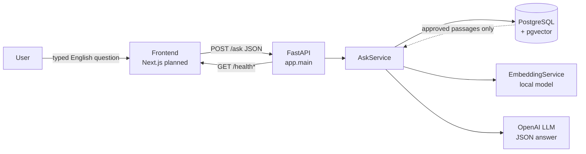
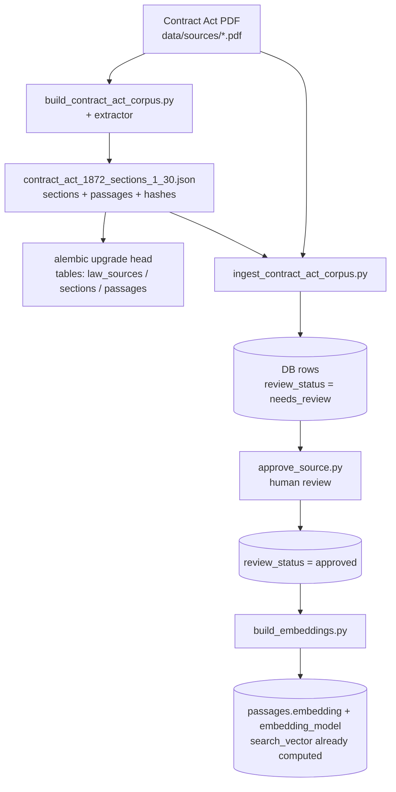
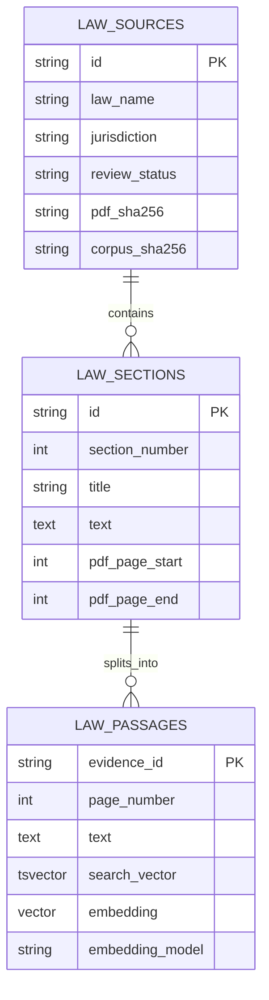
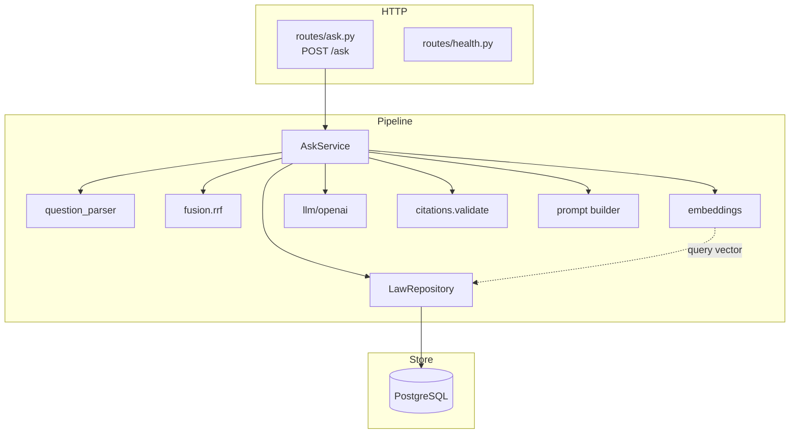
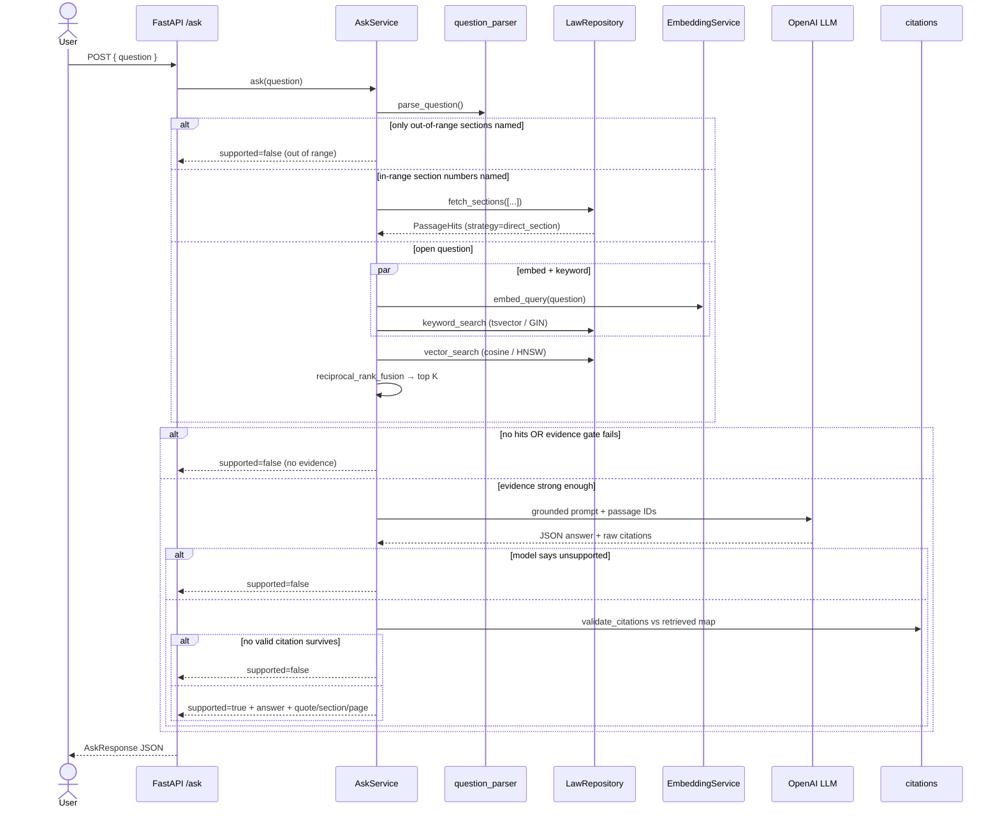
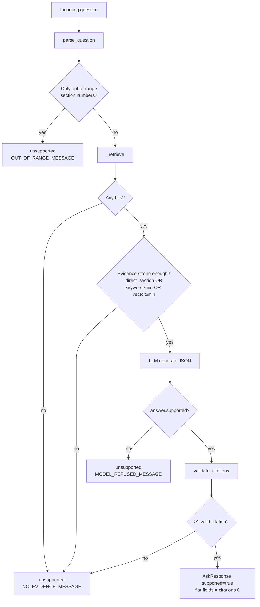
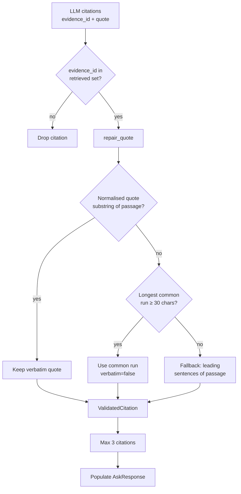
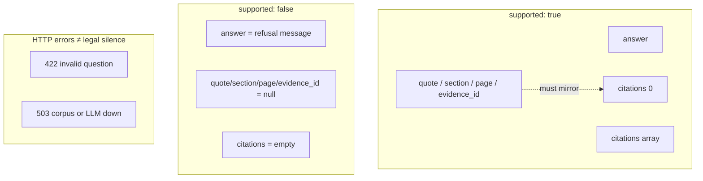
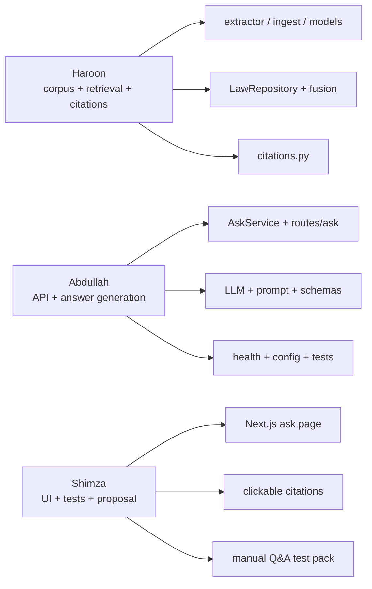

# LegalMind AI — System Workflow Diagrams

Technical diagrams for Sprint 1: **Contract-Law Q&A with Source Citations**  
Corpus: Contract Act, 1872 (Pakistan), sections **1–30**  
Stack: Next.js (planned UI) · FastAPI · PostgreSQL + pgvector

These diagrams reflect the **implemented backend** in `legalmind-backend` (`AskService`, `LawRepository`, citation validation, corpus ingest).

---

## 1. System context (what talks to what)



**Idea:** The UI never talks to the LLM or the database. FastAPI owns retrieval, grounding, and citation checks.

---

## 2. Offline corpus pipeline (what we built before Q&A works)



**Gates that matter:**

| Step | Why it exists |
|------|----------------|
| PDF + JSON SHA checks | Corpus bytes must match the reviewed PDF |
| `needs_review` → `approved` | Extraction alone cannot go live |
| Embeddings script separate | Search never mixes two embedding models |

---

## 3. Data model (citation truth)



**Citation key = `evidence_id`** on `law_passages` (one section fragment on one PDF page).  
Every retrieval query joins sources and **filters `review_status`**.

---

## 4. Runtime component map (backend modules)



---

## 5. End-to-end POST /ask sequence



---

## 6. AskService decision flowchart (refusal gates)



**Design rule from code:** an unanswerable question must **not** reach a guessing model when evidence is weak (gate before LLM). If the model cites nothing we retrieved, the answer is still dropped.

---

## 7. Hybrid retrieval detail

```mermaid
flowchart LR
  Q[Question text] --> KW[Keyword path<br/>websearch_to_tsquery<br/>ts_rank_cd on search_vector]
  Q --> VEC[Vector path<br/>embed_query → cosine<br/>embedding <=> query]
  KW --> RRF[Reciprocal Rank Fusion<br/>score = Σ 1/(k + rank)]
  VEC --> RRF
  RRF --> TOP[Top K FusedHits<br/>with evidence_id]

  Q2[Question names section N] --> DIR[fetch_sections<br/>skip hybrid]
  DIR --> TOP2[FusedHits<br/>retriever=section]
```

| Retriever | Signal | Index |
|-----------|--------|--------|
| `section` | Explicit “section 10” etc. | PK / section_number |
| `keyword` | Lexical / statute wording | GIN on `search_vector` |
| `vector` | Semantic similarity | HNSW on `embedding` (same `embedding_model` only) |

**Fallback:** if strict FTS returns empty → loose OR `to_tsquery` on content words (stopwords removed).  
**Degrade:** if embeddings fail/disabled → `strategy=keyword_only`.

---

## 8. Citation validation (anti-hallucination)



---

## 9. Response contract (frontend-facing)



**Product rule:** HTTP **503** means “retry later”; **`supported: false`** means “this corpus cannot answer.”

---

## 10. Sprint ownership → code areas



---

## How to view

- **GitHub:** open this file; Mermaid renders automatically.
- **Local HTML:** open `docs/system_workflows.html` in a browser.
- **Source of truth:** `app/services/ask_service.py` docstring and pipeline code.
